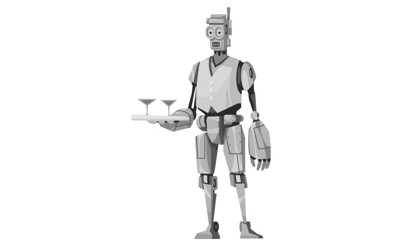
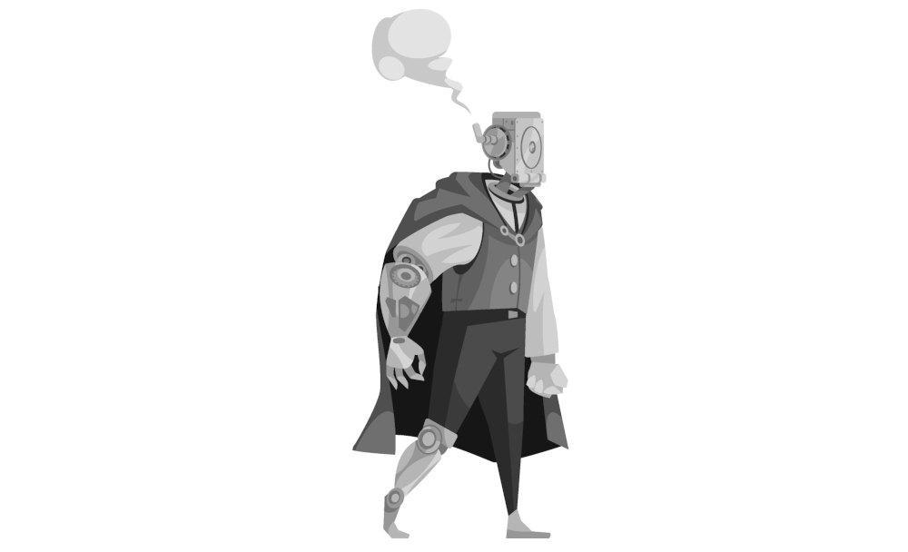

\sinc

# Modern World 

\conc

_… es una aventura creada por [Gwannon](https://gwannon.com/) para [Lady Blackbird RPG](https://ladyblackbird.org/) de John Harper._

Modern World es un resort y parque temático al que van los ricos y ociosos de Ilysium a divertirse. En este parque hay automatas eléctricos, llamados maniquíes, que representan el mundo futuro de las noveluchas baratas futuristas donde el vapor y el carbón han dado paso a la electricidad y las velas solares.

El imperio ha visto la capacidad de usar militarmente los inventos desarrollados por August Thornberry, propietario de Modern World, y su grupo de ingenieros goblins, pero estos han rechazado venderle su tecnología.

El imperio no lleva bien el rechazo. Si no se la dan por las buenas, tendrá que mandar un destructor para que la coja por la fuerza.

Lo que nadie sabe es que Thornberry no es un genio inventor, solo es un farsante con un pico de oro al que los goblins Yalp, Snot y Dez, los verdaderos genios de la electricidad, contrataron para ser la cara visible del parque y que firmara los avales bancarios. Ningún banco de Ilysium pondría dinero para las locas ideas de tres goblins.

Antes de que el Devastador entre en la atmosfera del planetoide y sus fuerzas de asalto terrestre tomen Modern World, deberán destruir las instalaciones del parque, para que el imperio no se quede con sus descubrimientos tecnológicos que le dan su magia a este lugar.

Pero esto no acaba ahí, tendrán que escapar del Devastador, ya que, si alguno de los goblins cae prisionero, será obligado a revelar sus secretos científicos como sea, incluso con torturas.

\sinc

## El parque

\conc

Modern World es único en su especie. Es como titulaba la prensa «El lugar más increíble del imperio». Todos los años, miles de personas de alta alcurnia lo visita y solo pueden hablar maravillas a sus conocidos cuando vuelven a casa.

El planetoide donde ha sido construido el parque tiene todo un sistema de velas solares que alimentan un gigantesco motor espacial de forma que el planetoide es en realidad una nave espacial totalmente funcional, aunque extremadamente lenta.

\sp

Tiene un amplio espacio puerto para que los ricos y poderosos del Ilysium puedan aterrizar con sus pomposas naves, tras pagar unas desorbitadas tasas de aterrizaje.

Desde allí, pueden acceder al _resort_ donde son acomodados en sus lujosas _suites_. Tras refrescarse en sus habitaciones o tomar un buen tentempié pueden entrar en el parque y disfrutar de sus maravillas como el Vuelo del Ave de Trueno de West World o el Laberinto de kevlar de East World.

En el _resort_ solo hay humanos, cocineros, camareros, azafatos, limpiadores, conserjes, etc. Por el contrario, en el parque solo hay maniquís electro-autónomos que se encargan de animar las diferentes atracciones y los espectáculos del parque y vender comida o souvenirs.

Solo hay unos pocos humanos y goblins que se dedican al mantenimiento de maniquís y atracciones o actividades más delicadas como los masajes y los tratamientos estéticos que se ofrecen en las termas.

El parque está dividido en 5 secciones, una central y las otras 4 alrededor al norte, sur, este y oeste. Cada sección del parte está montada siguiendo una saga de libros baratos de a 5 créditos, libros que los goblins devoraban en su niñez.

### Modern World

Está sección que da nombre al parque está en el centro. Representa nuestro mundo, pero en un futuro eléctrico.

Hay maniquís que lustran tus zapatos, otros que entregan periódicos y folletos, otros que tiran de _rickshaws_ y te llevan a donde quieras, otros cortan setos, etc. También hay muchos andan por las calles y entran y salen de edificios simulando que son oficinistas, contables y secretarios que entran y salen de sus trabajos.

Cada poco tiempo hay un desfile de maniquís con una banda de música de maniquís y carrozas celebrando las bondades de la electricidad y cómo se produce.

### North World

Es un mundo de dioses y héroes de los viejos mitos. Templos de mármol, suelos de piedra, criptas escondidas y fastuosas termas donde los visitantes se relajan y reciben otras atenciones terapéuticas como masajes y libaciones.

Los visitantes son tratados como héroes a los que se alaba y se les ofrece ambrosía.

Los desfiles militares, las carreras de cuadrigas eléctricas y los combates de gladiadores electrificados son frecuentes.

### South World

Esta zona es un gigantesco zoo con maniquís eléctricos con muchas especies de animales salvajes. 

\sp

Hay zonas de selva, sabana, estepa e incluso tundra. Un montón de ecosistemas que llevan años extintos.

En estas zonas hay mamuts, bisontes, grandes felinos, aves de todos los colores y reptiles de gran tamaño y aún más grandes dientes y garras.

### East World

En la parte este tenemos East World, un pastiche de mitos y cuentos de lo más recóndito del espacio conocido, con príncipes y princesas alienígenas, extrañas y gigantescas bestias de carga o guerra y exóticos palacios con pasadizos secretos.

Duelos de electro-espadas aderezadas con acrobacias imposibles, llamaradas y rayos y poderosos videntes que te leen la buenaventura.

Y todo finalmente aderezado con bailes acompañados de los chirridos de montones de articulaciones y engranajes metálicos.

### West World

En la parte oeste se encuentra West World, una especie de frontera futurista con cowboys montados en caballos androides, vacas con placas solares de las que ordeñas electricidad y pistolas de rayos eléctricos. 

Duelos al amanecer, robos de bancos, asaltos a trenes y peleas en el _saloon_ son las atracciones típicas de esta zona, aparte del Vuelo del Ave de Trueno, la atracción más alucinante creada por el hombre (o los goblins).

### Moverse entre zonas

Modern World se encuentra en el centro del parque y el resto de mundos se encuentra se encuentran al norte, al sur, al este y al oeste, siguiendo su nombre. Se decidió así para que los visitantes pudieran orientarse fácilmente. Esto quiere decir que para moverse de una zona a otra siempre tendrán que pasar por Modern World.

La forma más fácil de moverse es por la superficie del parque, pero eso no quiere decir que no haya un submundo de túneles, pasillos por debajo del parque que usan para el mantenimiento. Es complicado moverse por aquí, pero es la forma perfecta de moverse de manera segura y sin ser visto. 

\sinc

## Tecnología punta

\conc

La tecnología electrónica usada en el parque por Yalp, Snot y Dez es muy superior a la del resto de investigadores científicos del Imperio.

Por un lado, su electricidad y sus velas solares es el doble de poderosa que el vapor y el carbón que usa el resto del mundo. Sus inventos pueden funcionar durante días sin tener que recargar sus baterías durante días gracias a sus velas solares que convierten la luz en electricidad.

\sp

Sus maniquíes eléctricos tienen una ingeniería increíble que replica músculos y huesos de humanos y animales a la perfección. Incluso hay movimientos que los maniquíes eléctricos hacen mejor y más rápido que los humanos.

El tercer y más importante desarrollo tecnológico son sus cerebros eléctricos que superan a las máquinas pensantes mecánicas que usa el imperio. 
Esos cerebros electrónicos son de un tamaño muchísimo menor y pueden programarse de muchas más maneras, con programas más complejos, por ejemplo, programando la producción de voces a través de sistemas de altavoces.

Lo interesante es que Yalp, Snot y Dez, en vez de vender sus inventos al mejor postor, lo dirigieron a crear un lugar de diversión y entretenimiento. Esto es lo que más sorprendió a los altos cargos del Imperio cuando pusieron sus ojos en estas nuevas tecnologías electrónicas.

Los goblins consideran toda esta tecnología como suya y verla en manos de otros usándose con fines militares les es inconcebible.

Ten muy claro que antes la destruyen a tener que entregarla al Imperio. Incluso podrían sacrificarse para evitar que caiga en malos manos.

\sinc

## El plan

\conc

Una vez evacuado el parque tus jugadores deberían buscar la forma de evitar que la Flota Imperial se haga con su tecnología. Si cae en malas manos como las del Imperio, podría ser un desastre.

Tus jugadores crearon esa tecnología para ayudar y hacer feliz a la gente, y, claro, hacer algo de dinero. Así que antes de huir del planetoide deben inutilizarla.

August será siempre el objetivo principal de las tropas de asalto del Devastador. Cómo todos saben, es el genio científico detrás de toda la tecnología del parque. Si lo atrapan podrán sacarle todos los secretos que desean. Según sus informes, los goblins son simples ayudantes de laboratorio.

El único plan posible para destruir su tecnología es ir a cada zona y llegar a su centro de control. Desde cada uno de ellos se puede desactivar todos los maniquíes y las atracciones de la zona y luego sobrecargarlos y freír sus circuitos haciéndoles inservibles.

El último paso sería destruir cada centro de control para asegurarse de que no queda nada aprovechable. Lo más sencillo sería usar explosivos, pero si no tienen a mano TNT, pueden ser creativos.

\sp

* En North World, hay actividad volcánica, de ahí sus famosas termas.
* El de South World tiene cerca un gasoducto de gas extraído del planetoide.
* West World es desde donde se lanza la pirotécnica del parque, así que hay posibilidad de usarla.
* El centro de East World está debajo del lago central. Podrían inundarlo.
* Modern World no tiene a priori ningún punto débil.

En Moderno World, además de la zona de control, donde empezarán, tendrán que destruir su laboratorio, eso debería ser especialmente duro para los 3 Goblins, ya que es destruir el trabajo de toda una vida.

Está sección debe ser la última en destruirse porque la necesitan funcional para moverse entre secciones del parque y llegar al espacio puerto en el auto tren lanzadera. Además, tendrán que hacerlo a distancia, ya que si lo destruyen antes de llegar al espacio puerto el auto tren se parará en mitad de la vía.

La misión de destrucción tiene un tiempo máximo. Crea un reloj con 9 secciones, cada vez que ejecuten un plan de sabotaje fallido o exitoso rellena una sección. Cuando se rellenen todos, el Devastador aterrizará y las tropas de asalto se harán con el control de lo que quede en pie del parque.

Separarse puede ser una opción interesante, pero uno de los goblins deberá trabajar con August que es bastante inútil en temas de ciencia. 

El último paso es llegar al espacio puerto y huir, porque si son atrasados, no habrá servido de nada todos sus esfuerzos. El Imperio pondrán a trabajar a sus mejores interrogadores/torturadores para sacar sus secretos tecnológicos a tus jugadores.

La huida exige una sección del reloj, así que el tiempo es muy limitado. Para empezar necesitan 5 secciones del reloj para destruir todo el parque, más la de la huida. Eso los deja solo 3 posibles fallos.

> Cómo podrás ver, destruir todas las zonas y escapar antes de que las tropas de asalto del Devastador tomen el parque es prácticamente imposible. Alguien deberá sacrificarse y quedarse o deberán abandonarle por el bien del grupo. Es algo que al principio no es palpable, pero que poco a poco se irá haciendo muy real según se vayan rellenando las secciones del reloj.

\sinc

&nbsp;

\conc

\sp

|ModernWorldEncuentros.md|

\sp

|ModernWorldPersonajes.md|

\sp

|Licencia.md|