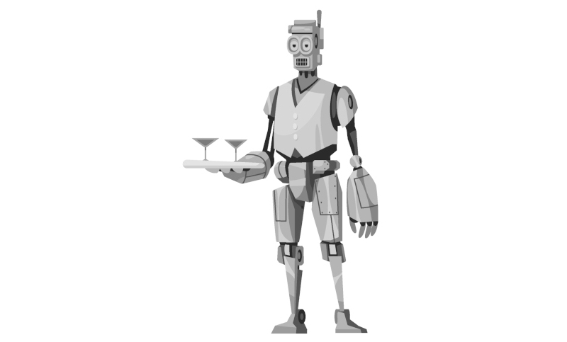
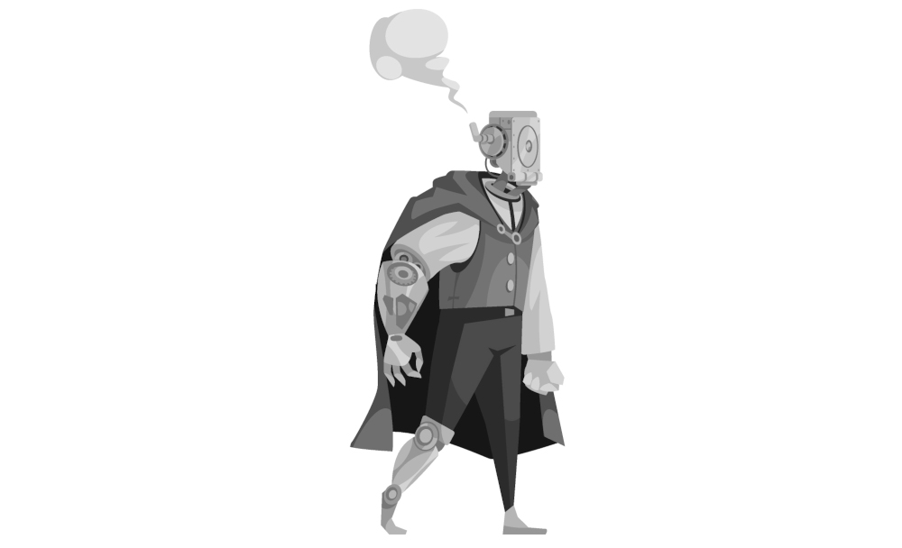

\sinc

# Modern World 

\conc

_… is an adventure created by [Gwannon](https://gwannon.com/) for John Harper's [Lady Blackbird RPG](https://ladyblackbird.org/)._

Modern World is a resort and amusement park where the richest people of Ilysium go to amuse themselves. The park features electric automatons, known as mannequins, that evoke the future described in the cheap, pulp-style science fiction novels, a world where steam and coal have given way to electricity and solar sails.

The Empire has recognized the potential for military use of the inventions developed by August Thornberry, owner of Modern World, and his group of goblin engineers, but they have refused to sell their technology to the empire.

The Empire does not take rejection well. If it isn’t handed over willingly, it will have to send a destroyer to take it by force.

What no one knows is that Thornberry is no genius inventor. He is merely a charlatan with a silver tongue, hired by the goblins Yalp, Snot, and Dez ,the true electrical geniuses, to serve as the public face of the park and to sign for bank loans. No bank in Ilysium would ever provide funding for the mad ideas of three goblins.

Before the Devastator enters the planetoid’s atmosphere and its ground assault forces conquest Modern World, they must destroy the park’s facilities, ensuring the Empire cannot get its hands on the technological discoveries that give this place its magic.

But it doesn’t end there; they will have to escape from the Devastator, for if any of the goblins are taken prisoner, they will be forced to reveal their scientific secrets by any means necessary, even through torture.

\sinc

## The Amusement Park

\conc

Modern World is one of a kind. It is, as the press once titled it, «The most incredible place in the Empire». Every year, thousands of rich persons visit it, and upon returning home, they can speak only in glowing terms to those they know.

The planetoid on which the park has been built has an entire system of solar sails that power a massive space engine, making the planetoid, in effect, a fully functional, but extremely slow, starship.

\sp

It has a spacious spaceport where the rich and powerful people of Ilysium can land their ostentatious ships—after paying exorbitant landing fees.

From there, they can access the resort, where they are accommodated in their luxurious suites. After freshening up in their rooms or enjoying a nice meal, they can enter the park and experience its wonders, such as the Thunderbird Flight in West World or the Kevlar Labyrinth in East World.

At the resort, there are only humans, chefs, waiters, attendants, cleaning staff, belboy, and so on. In contrast, the park contains only autonomous, motorized mannequins tasked with enlivening the various attractions and shows, as well as selling food or souvenirs.

There are only a few humans and goblins dedicated to the maintenance of mannequins and attractions, or to more delicate tasks such as the massages and beauty treatments offered at the thermal baths.

The park is divided into 5 zones: one central zone, with the other 4 arranged around it to the north, south, east, and west. Each zone of the park is themed after a series of cheap, 5-credit books, the kind the goblins used to devour in their childhood and freetime.

### Modern World

This zone, which gives the park its name, is located in the center. It represents our world, but in an electric future.

There are mannequins that polish your shoes, others that sell newspapers and leaflets, others that pull rickshaws and take you wherever you want to go, others that trim hedges, and so on. There are also many that walk along the streets, entering and leaving buildings as if they were office workers, accountants, or secretaries arriving at or leaving their workplaces.

Every so often, there is a parade of mannequins, complete with a mannequin marching band and decorated platforms, celebrating the benefits of electricity and how it is produced.

### North World

It is a world of gods and heroes from ancient myths. There are marble temples, mosaics, hidden crypts, and sumptuous thermal baths where visitors relax and enjoy therapeutic treatments, such as massages and libations.

Visitors are treated like heroes, with praises and delicious plates.

Military parades, electric-chariot races, and electrified gladiator combat are very commons.

### South World

This zone is a vast zoo featuring electric animatronic figures of many species of wild animals.

\sp

There are areas of jungle, savanna, steppe, and even tundra, a multitude of ecosystems that have been extinct for years.

In these regions, one finds mammoths, bison, large felines, birds of every color, and massive reptiles with even larger teeth and claws.

### East World

In the east are East World, a pastiche of myths and tales drawn from the farthest reaches of known space, featuring alien princes and princesses, strange, gargantuan beasts of burden or war, and exotic palaces with secret passageways.

There are duels fought with electro-swords while impossible acrobatics are developed, bursts of flame, and bolts of energy, as well as powerful seers who can read your fortune.

And as great finale there are dances accompanied by the screeching of countless metallic joints and gears.

### West World

En la parte oeste se encuentra West World, una especie de frontera futurista con cowboys montados en caballos androides, vacas con placas solares de las que ordeñas electricidad y pistolas de rayos eléctricos. 

Duelos al amanecer, robos de bancos, asaltos a trenes y peleas en el _saloon_ son las atracciones típicas de esta zona, aparte del Vuelo del Ave de Trueno, la atracción más alucinante creada por el hombre (o los goblins).

### Moving between zones

Modern World se encuentra en el centro del parque y el resto de mundos se encuentra se encuentran al norte, al sur, al este y al oeste, siguiendo su nombre. Se decidió así para que los visitantes pudieran orientarse fácilmente. Esto quiere decir que para moverse de una zona a otra siempre tendrán que pasar por Modern World.

La forma más fácil de moverse es por la superficie del parque, pero eso no quiere decir que no haya un submundo de túneles, pasillos por debajo del parque que usan para el mantenimiento. Es complicado moverse por aquí, pero es la forma perfecta de moverse de manera segura y sin ser visto. 

\sinc

## High tech

\conc

La tecnología electrónica usada en el parque por Yalp, Snot y Dez es muy superior a la del resto de investigadores científicos del Imperio.

Por un lado, su electricidad y sus velas solares es el doble de poderosa que el vapor y el carbón que usa el resto del mundo. Sus inventos pueden funcionar durante días sin tener que recargar sus baterías durante días gracias a sus velas solares que convierten la luz en electricidad.

\sp

Sus maniquíes eléctricos tienen una ingeniería increíble que replica músculos y huesos de humanos y animales a la perfección. Incluso hay movimientos que los maniquíes eléctricos hacen mejor y más rápido que los humanos.

El tercer y más importante desarrollo tecnológico son sus cerebros eléctricos que superan a las máquinas pensantes mecánicas que usa el Imperio. 
Esos cerebros electrónicos son de un tamaño muchísimo menor y pueden programarse de muchas más maneras, con programas más complejos, por ejemplo, programando la producción de voces a través de sistemas de altavoces.

Lo interesante es que Yalp, Snot y Dez, en vez de vender sus inventos al mejor postor, lo dirigieron a crear un lugar de diversión y entretenimiento. Esto es lo que más sorprendió a los altos cargos del Imperio cuando pusieron sus ojos en estas nuevas tecnologías electrónicas.

Los goblins consideran toda esta tecnología como suya y verla en manos de otros usándose con fines militares les es inconcebible.

Ten muy claro que antes la destruyen a tener que entregarla al Imperio. Incluso podrían sacrificarse para evitar que caiga en malos manos.

\sinc

## The plan

\conc

Una vez evacuado el parque tus jugadores deberían buscar la forma de evitar que la Flota Imperial se haga con su tecnología. Si cae en malas manos como las del Imperio, podría ser un desastre.

Tus jugadores crearon esa tecnología para ayudar y hacer feliz a la gente, y, claro, hacer algo de dinero. Así que antes de huir del planetoide deben inutilizarla.

August será siempre el objetivo principal de las tropas de asalto del Devastador. Cómo todos saben, es el genio científico detrás de toda la tecnología del parque. Si lo atrapan podrán sacarle todos los secretos que desean. Según sus informes, los goblins son simples ayudantes de laboratorio.

El único plan posible para destruir su tecnología es ir a cada zona y llegar a su centro de control. Desde cada uno de ellos se puede desactivar todos los maniquíes y las atracciones de la zona y luego sobrecargarlos y freír sus circuitos haciéndoles inservibles.

El último paso sería destruir cada centro de control para asegurarse de que no queda nada aprovechable. Lo más sencillo sería usar explosivos, pero si no tienen a mano TNT, pueden ser creativos.

\sp

* En North World, hay actividad volcánica, de ahí sus famosas termas.
* El de South World tiene cerca un gasoducto de gas extraído del planetoide.
* West World es desde donde se lanza la pirotécnica del parque, así que hay posibilidad de usarla.
* El centro de East World está debajo del lago central. Podrían inundarlo.
* Modern World no tiene a priori ningún punto débil.

En Moderno World, además de la zona de control, donde empezarán, tendrán que destruir su laboratorio, eso debería ser especialmente duro para los 3 Goblins, ya que es destruir el trabajo de toda una vida.

Está sección debe ser la última en destruirse porque la necesitan funcional para moverse entre secciones del parque y llegar al espacio puerto en el auto tren lanzadera. Además, tendrán que hacerlo a distancia, ya que si lo destruyen antes de llegar al espacio puerto el auto tren se parará en mitad de la vía.

La misión de destrucción tiene un tiempo máximo. Crea un reloj con 9 secciones, cada vez que ejecuten un plan de sabotaje fallido o exitoso rellena una sección. Cuando se rellenen todos, el Devastador aterrizará y las tropas de asalto se harán con el control de lo que quede en pie del parque.

Separarse puede ser una opción interesante, pero uno de los goblins deberá trabajar con August que es bastante inútil en temas de ciencia. 

El último paso es llegar al espacio puerto y huir, porque si son atrasados, no habrá servido de nada todos sus esfuerzos. El Imperio pondrá a trabajar a sus mejores interrogadores/torturadores para sacar sus secretos tecnológicos a tus jugadores.

La huida exige una sección del reloj, así que el tiempo es muy limitado. Para empezar necesitan 5 secciones del reloj para destruir todo el parque, más la de la huida. Eso los deja solo 3 posibles fallos.

> Cómo podrás ver, destruir todas las zonas y escapar antes de que las tropas de asalto del Devastador tomen el parque es prácticamente imposible. Alguien deberá sacrificarse y quedarse o deberán abandonarle por el bien del grupo. Es algo que al principio no es palpable, pero que poco a poco se irá haciendo muy real según se vayan rellenando las secciones del reloj.

\sinc

&nbsp;

\conc

\sp

|ModernWorldEncuentrosEN.md|

\sp

|ModernWorldPersonajesEN.md|

\sp

|LicenciaEN.md|