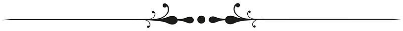

\sinc

## Characters

\conc

Although Modern World is owned by August Thornberry, its board of directors consists of him and the three goblin engineers who created all the park’s marvels: Yalp, Snot, and Dez.

When the Devastator appeared on the radar, the board ordered the evacuation of all park staff and visitors for their own safety; as a result, they are now the only four individuals remaining within the entire facility.

### Power dynamics

Throughout the time the park has been open, power dynamics have remained very stable. Everyone knew their place, as well as the limits of their own power and influence.

All of that went out the window when the Devastator set a course for Modern World, its cannons primed and ready to fire.

**August** has always been the company’s figurehead, he had no real say in anything, but that has just changed. He is now a full participant in this risky task. He has the capacity to decide how he wants to act, and his opinion must be taken into account by the rest of the group. Not to mention that his skills are now of great value.

**Yalp** you are the oldest and most experienced of the goblins, It was your ideas that gave rise to the technology that brings the park to life. For a long time, you have been the leader of the group, but you are getting older, and your ideas are no longer as good as they once were. The younger ones are coming on strong, but they still have much to learn—and you are going to be the one to teach them.

**Snott** sYou’re not a genius, but you’re the one who takes care of fixing the little problems that no one else bothers with. Without you, nothing would keep running for two days in a row, though the others don’t seem to realize that. You might not fully grasp how the electronic brain inside a mannequin works—the thing that enables it to perform all those amazing feats, but you’ve managed to keep them running for days without needing a recharge, and that’s important, too. Honestly, a little recognition would be quite nice.

**Dez** is the youngest of them all, and for that reason his ideas have always been undervalued, but his potential is immense, like a supernova on the verge of exploding. Perhaps now his ideas will be heard.

> Although the characters are all male, this is merely a suggestion. You are free to adapt them however you like; in fact, ask your players to define their characters' pronouns when they choose their characters.

\sp

\sinc

### August Thornberry

A trickster, part gentleman, part thief, who targets the wealthy and powerful ones and who has ended up under the command of three goblins while acting as a famous inventor.

\conc

**TRAITS & TAGS**
* Caballero
  * 🞊 _Etiqueta_
  * 🞊 _Elegancia_
  * 🞊 _Caballería_
  * 🞊 _Baile_
  * 🞊 _Gallardía_
  * 🞊 _Proteger_
  * 🞆 _Puñetazos_
  * 🞆 _Valiente_
* Truhan
  * 🞊 _Adular_
  * 🞊 _Flirtear_
  * 🞊 _Charla de alcoba_
  * 🞊 _Casino_
  * 🞊 _Tirarse faroles_
  * 🞊 _Modales finos_   
  * 🞆 _Bailar_
  * 🞆 _Fingir acentos_
  * 🞆 _Preparar desayunos_
* Atleta
  * 🞊 _Correr_
  * 🞊 _Esgrima_
  * 🞊 _Estoque_
  * 🞊 _Duelista_
  * 🞊 _Disparar_
  * 🞆 _Pistola_
  * 🞆 _Acrobacias_
* Ladrón
  * 🞊 _Robar bolsillos_
  * 🞊 _Juegos de manos_
  * 🞊 _Cerraduras_
  * 🞊 _Escapismo_
  * 🞊 _Distraer_
  * 🞊 _Disfrazarse_
  * 🞊 _Pasar inadvertido_
  * 🞆 _Cerraduras de seguridad_
  * 🞆 _Explosivos_
  * 🞆 _Falsificar_

**KEYS**
* **Clave del seductor:** _Eres un ligón casi patológico que no puede perder una oportunidad de flirtear. Activa esta clave cuando flirtees incluso en los momentos menos oportunos y con las personas menos adecuadas. CANCELAR: cuando evitas tratar de seducir a un objetivo fácil y accesible._
* **Clave de las manos largas:** _Te gusta robar por la emoción, el riesgo y la adrenalina. Activa esta clave cuando robes cosas pequeñas y valiosas. CANCELAR: No robar algo valioso y accesible o devolverlo._
* **Clave del huérfano:** _Creciste en solo en las calles y no puedes dejar a niñes desvalides. Activa esta clave cuando ayudes a niñes. CANCELAR: Cuando ignoras una petición de ayuda._

**SECRETS**
* **Secreto del afortunado:** _Una vez por sesión puedes quedarte todos los dados de tu reserva cuando tengas éxito (aprovecha y úsalos todos)._
* **Secreto del ladrón:** _Una vez por sesión, puedes repetir un fallo cuando te escondas, trates de abrir cerraduras, robar bolsillos y otras actividades de ladrón._

* **CONDITIONS**
  * 🞏 INJURED
  * 🞏 TIRED
  * 🞏 ANGRY
  * 🞏 LOST
  * 🞏 HUNTED
  * 🞏 TRAPPED
  * 🞏 SUFFOCATED
  * 🞏 ELECTROCUTED
  * 🞏 DEAD (PRESUMED)

**ITEMS:** Ropas de muy buena calidad, periódico, monóculo, peine, cera de bigote, bastón-espada y una petaca de licor.

**APPEARANCE:** Bien arreglado, bien peinado, bien vestido y sobre todo con un porte espectacular. Su tupido bigote siempre está perfectamente aceitado. Él sabe cómo hacer que todo lo que se pone reluzca.

\sp

\sinc

### Yalp

An old goblin who has dedicated his life to science. His problem is that he no longer possesses the energy of youth, and the ideas that were once innovative are beginning to grow old and obsolete.

\conc

**TRAITS & TAGS**
* Ingeniero
  * 🞊 _Motor de vapor_
  * 🞊 _Metalurgia_
  * 🞊 _Química_
  * 🞊 _Electricidad_
  * 🞊 _Analizar_
  * 🞆 _Computación_
  * 🞆 _Engranajes_
* Goblin
  * 🞊 _Shapeshifting_
  * 🞊 _Connections_
  * 🞊 _Nightvision_
  * 🞊 _Teeth & Claws_
  * 🞆 _Mimic Shape_
  * 🞆 _Planning_
  * 🞆 _Adaptable armor_
  * 🞆 _Body pouch_
* Sindicalista
  * 🞊 _Atizar_
  * 🞊 _Correr_
  * 🞊 _Emboscar_
  * 🞊 _Emboscar_
  * 🞊 _Negociar_
  + 🞊 _Intimidar_
  * 🞆 _Leyes_
* Saboteador
  * 🞊 _Explosivos_
  * 🞊 _Planificar_
  * 🞊 _Ocultar_
  * 🞆 _Falsificar_
  * 🞆 _Trampas_

**KEYS**
* **Clave del líder:** _Eres el líder no porque quieras sino porque debes. Activa está clave cuando tomes el mando y lideres al grupo. CANCELAR: Cedas el mando a otros._
* **Clave del sueño de toda una vida:** _El parque ha sido tu sueño desde que eras un pequeño goblin, pero tu deber es destruirlo. Activa está clave cuando destruyas elementos del parque sin necesidad, solo por asegurarte de que cae en malas manos. CANCELAR: Cuando tratas de salvar algo del parque._
* **Clave senil:** _Te haces mayor y tu cuerpo empieza fallar. Activa está clave cuando intentas esfuerzos a actividades físicas extras que seguramente acabarás pagando. CANCELAR: Cuando encargas a otros esfuerzos físicos, que podrías asumir tú._

**SECRETS**
* **Secreto del cambiaformas:** _Como goblin, puedes cambiar de forma, encogiendo, creciendo, engordando, adelgazando, o cambiando tu color de piel, a voluntad._
* **Secreto de la cadena de mando:** _Una vez por recuperación, puedes darle a una persona que esté bajo tus órdenes la oportunidad de volver a realizar una tirada fallida._

* **CONDITIONS**
  * 🞏 INJURED
  * 🞏 TIRED
  * 🞏 ANGRY
  * 🞏 LOST
  * 🞏 HUNTED
  * 🞏 TRAPPED
  * 🞏 SUFFOCATED
  * 🞏 ELECTROCUTED
  * 🞏 DEAD (PRESUMED)

**ITEMS:** Equipo de protección en el trabajo (guantes, botas, casco, gafas de soldar) y cinturón de herramientas con todo tipo de herramientas. Alguna de ellas podría usarse de arma contundente.

**APPEARANCE:** Un goblin ya mayor con varias cicatrices y quemaduras de haber trabajado en sitios muy duros en muy malas condiciones, lleva las típicas ropas de taller, peto vaquero, botas de trabajo, guantes, casco y gafas de soldar, duras y resistentes y muy prácticas.

\sp

\sinc

### Snot

A hardworking, steady, and resilient goblin mechanic who enjoys his job. He loves his work and has a passion for mechanics and electronics items.

\conc

**TRAITS & TAGS**

* Mantenimiento
  * 🞊 _Revisar_
  * 🞊 _Detectar problemas_
  * 🞊 _Conducir_
  * 🞊 _Leer planos_
  * 🞊 _Mejorar_
  * 🞆 _Crear herramientas_
  * 🞆 _Reemplazar_
  * 🞆 _Recabar información_
* Goblin
  * 🞊 _Shapeshifting_
  * 🞊 _Connections_
  * 🞊 _Nightvision_
  * 🞊 _Teeth & Claws_
  * 🞆 _Mimic Shape_
  * 🞆 _Planning_
  * 🞆 _Adaptable armor_
  * 🞆 _Body pouch_
* Chapucero
  * 🞊 _Identificar_
  * 🞊 _Improvisar_
  * 🞊 _Imperial_
  * 🞊 _Conductos_
  * 🞊 _Inalámbrico_
  * 🞊 _Buscar_
  * 🞊 _Reparar_
  * 🞆 _Piezas sueltas_
  * 🞆 _Baterías_
  * 🞆 _Explosivos_
* Animador
  * 🞊 _Dar ánimos_
  * 🞊 _Empatía_
  * 🞊 _Cantar_
  * 🞊 _Psicología_
  * 🞆 _Apoyar_
  * 🞆 _Confesor_

**KEYS**
* **Clave del manitas:** Si es algo tecnológico, es tu obligación saber como funciona. Activa esta clave cuando modifiques, mejores, repares o hagas una chapuza sobre alguna tecnología. CANCELAR: Deja pasar la oportunidad de enredarte con tecnología.
* **Clave de la deuda de vida:** _Yalp ha cuidado de ti desde que empezaste a trabajar en las grandes metalúrgicas, el único lugar donde daban trabajos a los goblins. Te ha sacado de muchos problemas y te ha protegido en lo más duro de las huelgas. Activa esta clave cuando sigas las órdenes de Yalp. CANCELAR: Al apoyar las nuevas, brillantes e innovadoras ideas de Dez._
* **Clave del trabajo:** _Te encanta tu trabajo. Activa esta clave al empezar una nueva tarea que nunca habías hecho. CANCELAR: Descansar demasiado tiempo._

**SECRETS**
* **Secreto del cambiaformas:** _Como goblin, puedes cambiar de forma, encogiendo, creciendo, engordando, adelgazando, o cambiando tu color de piel, a voluntad._
* **Secreto de la bolsa sin fondo:** _Una vez por recuperación, encuentras en tu bolsa justo la pieza que necesitas para poder seguir con vuestra misión._

* **CONDITIONS**
  * 🞏 INJURED
  * 🞏 TIRED
  * 🞏 ANGRY
  * 🞏 LOST
  * 🞏 HUNTED
  * 🞏 TRAPPED
  * 🞏 SUFFOCATED
  * 🞏 ELECTROCUTED
  * 🞏 DEAD (PRESUMED)

**ITEMS:** Ropas de trabajo, botas, guantes, mono de trabajo, gafas protectoras, casco y bandolera para las herramientas y piezas de recambio. Todos estos elementos han sido modificadas para ser más eficientes. Son pequeños y sencillos cambios, pero muy ingeniosos.

**APPEARANCE:** Goblin maduro con una sonrisa siempre en la cara sobre todo cuando trabaja en las cosas que le gustan. Las manos nunca están vacías, porque siempre está haciendo algo o va a hacer algo.

\sp

\sinc

### Dez

A young goblin genius whom no one takes seriously, yet, in all likelihood, it is thanks to him that a new technological era will begin.

\conc

**TRAITS & TAGS**
* Científico 
  * 🞊 _Nuevos materiales_
  * 🞊 _Química_
  * 🞊 _Física_
  * 🞊 _Computación_
  * 🞊 _Electrónica_
  * 🞆 _Computación avanzada_
  * 🞆 _Óptica_
  * 🞆 _Singularidad_
* Goblin
  * 🞊 _Shapeshifting_
  * 🞊 _Connections_
  * 🞊 _Nightvision_
  * 🞊 _Teeth & Claws_
  * 🞆 _Mimic Shape_
  * 🞆 _Planning_
  * 🞆 _Adaptable armor_
  * 🞆 _Body pouch_
* Investigador
  * 🞊 _Método científico_
  * 🞊 _Teorías_
  * 🞊 _Especulación_
  * 🞊 _Documentar_
  * 🞆 _Demostración empírica_
  * 🞆 _Defender tesis_
* Humanist
  * 🞊 _Philosophy_
  * 🞊 _Anthropology_
  * 🞊 _Medicine_
  * 🞊 _Psychology_
  * 🞆 _History_

**KEYS**
* **Clave del novato:** _Eres el novato, pero también el más brillante. Activa está clave cuando te haces oír y el resto escuchan tus planes. CANCELAR: Cuando no haces valer tus ideas y opiniones y te dejas pisotear._
* **Clave de la ciencia:** _La ciencia es tu vida y nada se interpondrá entre ella y tú. Activa está clave cuando descubras algo nuevo con potencial científico. CANCELAR: Si no investigas algo de interés científico._
* **Clave del maniquí:** _Los maniquíes, sobre todo los programados por ti, son cada vez más sofisticados y cada vez los sientes más humanos. Activa esta clave cuando los defiendas como si fueran personas reales. CANCELAR: Al sacrificarlos o destruirlos para llevar a cabo tus planes._

**SECRETS**
* **Secreto del cambiaformas:** _Como goblin, puedes cambiar de forma, encogiendo, creciendo, engordando, adelgazando, o cambiando tu color de piel, a voluntad._
* **Secreto de la genialidad:** _Eres un genio. Una vez por sesión, puedes repetir una tirada fallida de ingeniería, mecánica, electricidad, …_

* **CONDITIONS**
  * 🞏 INJURED
  * 🞏 TIRED
  * 🞏 ANGRY
  * 🞏 LOST
  * 🞏 HUNTED
  * 🞏 TRAPPED
  * 🞏 SUFFOCATED
  * 🞏 ELECTROCUTED
  * 🞏 DEAD (PRESUMED)

**ITEMS:** Bata de laboratorio llena de manchas de grasa, lápiz detrás de la oreja, bolsillos llenos de papeles con fórmulas e ideas, matraces y viales y algún tipo de herramienta con filo que puede usarse como arma cuerpo a cuerpo.

**APPEARANCE:** Con sus una gafas con cristales gruesos y su bata de laboratorio parece el típico científico despistado que no levanta los ojos de sus fórmulas y sus experimentos.

\sinc

&nbsp;

\conc