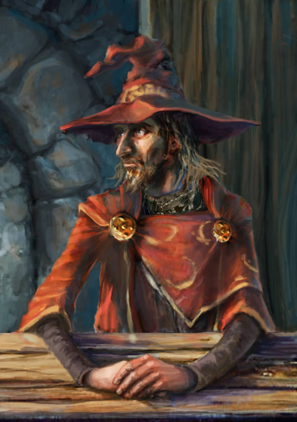
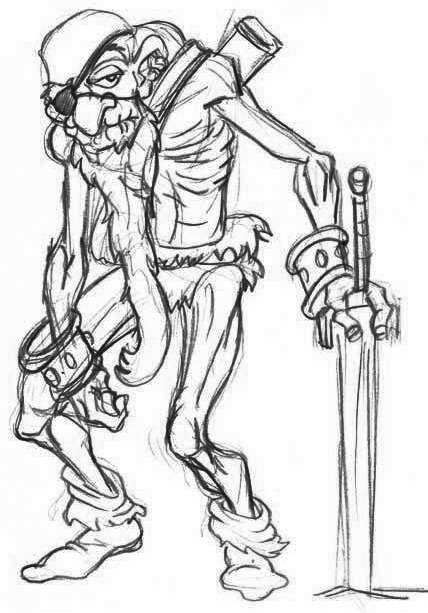
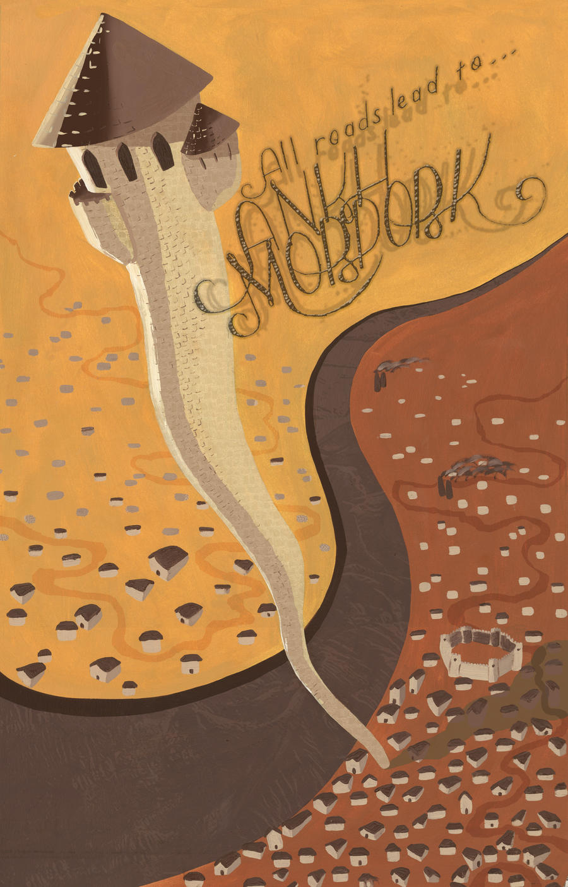
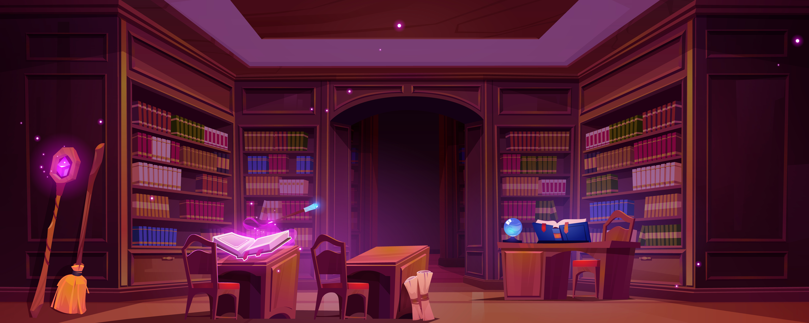
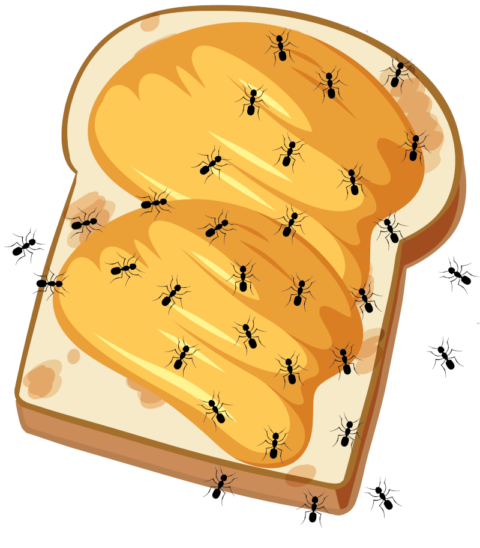

# La gran campaña **de Mundodisco**

**Una gran campaña para «Terry Pratchett’s Discworld: Adventures in Ankh-Morpork» de Gwannon**


## Índice


|INDICE|


«La gran campaña de Mundodisco», que no es tan grande como parece indicar su título, pero sí muy narcisista, es una ~~aventura larga~~ campaña NO OFICIAL para «Terry Pratchett’s Discworld: Adventures in Ankh-Morpork» para una directora de juego y de 1 a 4 jugadoras con personajes recién creados o muy poca experiencia.

---


Como este libro tiene un montón de páginas, he hecho una sinopsis rápida. En ella se explica en líneas generales la trama de la aventura, que claramente tus jugadoras no van a seguir, para ver si te llama y decides engañar a alguien para dirigírsela, porque ten claro que nadie en su sano juicio te la va a dirigir.

**Así que empecemos …**


## Sinopsis


### Capítulo 1. Dura lex, sed lex

Lord Vetinari, el patricio de Ankh-Morpork, dentro de sus políticas de reinserción social de criminales, permite conmutar las penas de cárcel a cambio de trabajar de entrevistadoras del censo electoral municipal.

Muy pocas han aceptado trabajar de encuestadoras para reducir sus condenas o librarse de ir a la cárcel, pero siempre hay nuevas tontas que creen que es una opción aceptable y hoy esas tontas son tus jugadoras.

La cuestión es que las simpáticas gentes del Ankh-Morpork no llevan bien que una desconocida llame a su puerta para hacerles preguntas en nombre del Patricio y lo normal es que acabes sobre la superficie del Ankh con afilados utensilios de cocina clavados en tu espalda.

### Capítulo 2. La Universidad Invisible

Tras varios intentos frustrados de rellenar algunas encuestas en Las Sombras (el barrio más antiguos, sucio y peligroso de Ankh-Morpork), Wilbuck, el encargado del censo decide cambiar de táctica y mandar a tu mesa a la Universidad Invisible a conocer la demografía mágica de la ciudad.

Allí conocerán a Spandau Ville, un joven hechicero, al que le han asignado la tarea de guiarles por la universidad. Durante su visita una pirata de clacs, llamada Trazcuatro, intentará hackear a HEX el superordenador mágico de la universidad y del que Spandau se encarga de su mantenimiento.

Si tus Trazcuatro necesitaba el superordenador para hacer unos cálculos y ver si su sistema de comunicación mediante tuberías de agua es factible, pero la pillan en mitad del proceso y deberán huir y tus jugadoras intentar atraparlas.


Una vez atrapada, cosa que no es fácil porque es muy escurridiza, les explicará su plan esperando que se apiaden de ella y la dejan libre o la entregan a la guardia, cosa que tus jugadoras deberán decidir.

A la vuelta al almacén donde Wilbuck guarda toda la información que recoge y que llama almacén de datos escuchará atentamente toda la aventura, especialmente el tema del nuevo sistema de comunicación. Con ese sistema podría conectar sin posibilidad de que lo pirateasen varios almacenes como el actual y hacer un censo mucho mejor.

### Capítulo 3. Luchadores por la democracia

Si no hacen algo, el tema del censo se va al garete. Así que tus jugadoras deberán devanarse los sesos para conseguir hacer las entrevistas, hasta que finalmente descubren el poder del chisme.

Gracias a los chismes, el censo va muy bien, demasiado bien incluso. Según Wilbuck en muy pocas semanas podrían tenerlo terminado y con ello, los aires de la democracia multipersonal podrían empezar a soplar y traer aire limpio a las malolientes calles de Ankh-Morpork, podridas por la pestilencia de la democracia unipersonal. 

XXX

### Capítulo 4. La caída del Patricio

XXX

Los almacenes de datos están gestionados por millones geniecillos ultrarrápidos que buscan los datos que Wilbuck requiere en segundos. Estos diablillos gastan muchísima agua para beber y asearse y eso está secando los manantiales de la ciudad. Además, comen muchísimos y defecan mucho más y sus purines acaban en el Ankh. Eso hace que en el Ankh huela aún peor y ya no se pueda ni pescar con un arpón andando sobre la superficie.

XXX

Cuando hayan descubierto todo el plan de Wilbuck, debería ser demasiado tarde para pararlo. Wilbuck sabe tanto que puede predecir cualquier cosa y con sus agentes censales, derrocará al Patricio y se autoproclamará el nuevo Patricio.

XXX

### Capítulo 5. La Résistance

XXX

La única manera de derrotarle es acabar con su fuente de poder, los edificios donde se guardan las encuestas y las estadísticas, o como Wilbuck llama, los almacenes de datos.

XXX

### Capítulo 6. El regreso del Patricio

XXX


## El plan de Wilbuck


Cómo practicante de la Esta-Listica, Wilbuck Moreless busca acumular la mayor cantidad de datos posibles para poder predecir las conductas de las ankhmorporkianas y del Patricio en concreto y dar un golpe de estado y ponerse él como nuevo Patricio.
 
Para ellos lleva años recavando datos y sacando estadísticas de infinidad de cosas, desde los resultados de los combates ilegales en el «Tambor roto» hasta el consumo de remolacha encurtida de la Universidad Invisible.

Parece una tontería, pero sabiendo el consumo de remolacha de los magos, sabes si están estreñidos o no y eso supone saber si están nerviosos y, por tanto, si va a pasar algo gordo o no.
 
Pero el dato definitivo que necesita Wilbuck es el censo municipal, que le permitirá predecir a las masas.

Para convencer a tus jugadoras de que le ayuden, les venderá que el censo es el primer paso de la democracia unipersonal de Lord Vetinari a una democracia multipersonal.

Tus jugadoras harán lo que sea para ayudarle en ese proyecto político radical, convencidas de que van a ayudar al pueblo oprimido de Ankh-Morpork.

Cuando consiga tener un censo lo suficientemente grande, podrá usar su magia porcentual y manipular a las masas para que derroquen al Patricio y le harán a él el nuevo dirigente de la ciudad.


# Reglas


Esta campaña tiene una serie de reglas especiales que, si bien no modifican las reglas generales de «Terry Pratchett’s Discworld: Adventures in Ankh-Morpork», añaden algunas nuevas para darle el sabor específico que se busca en esta campaña.

---


Seamos sinceros, son solo un montón de tonterías que NO HAN SIDO TESTEADAS, pero que en la mente del autor sonaban de fábula. En fin, puede que sean divertidas, si tu mesa se deja llevar.

Por resumir, aquí tienes reglas para llevar practicantes de la Esta-Listica, como funciona _la campaña_ con sus cameos y su tono «woke», además de reglas especiales para la creación de personajes.


## La Esta-Listica


La Esta-Listica (hay que pronunciarlo con voz grave, porque las cosas de la magia se pronuncian con voz grave) es la magia de los datos y los porcentajes y puede parecer banal, pero en un mundo muchas veces muy literal es una forma de magia muy poderosa.

Este tipo de magia permite predecir el futuro. En realidad permite saber qué posibilidad de las infinitas que pueden ocurrir es la más probable, que es como predecir el futuro.

El único problema es que en vez de gastar octarino, esencia, karma, chi o lo que sea que usen otras taumaturgas para hacer hechizos, en la Esta-Listica necesitas datos, recabar grandes cantidades de datos. Sin datos no puedes predecir una mierda.

Y no solo sirve para dar profecías y predicciones, tiene muchas otras aplicaciones. Puedes convertirte en un luchador excepcional si sabes que ataque es más probable que lance tu oponente, o un asesino implacable si sabes cuál es porcentaje de muertes por rayos en función del tamaño y material del paraguas.

El departamento de numerología de la Universidad Invisible no lo considera una forma de magia y lo desprecian llamándola «pseudo-magia» o «ciencia» a secas.

```
¿Qué es eso de porcentajes? Eso no son números mágicos de verdad, como el donce, son patrañas científicas de las modernas.
```
**Irving Visualblock, numerólogo**

Aun así las nuevas generaciones de numerólogos hacen sus pinitos con la Esta-Listica y no te extrañe que en unas décadas se impartan cursos de verano o incluso tenga su propia cátedra.


[](https://www.magnific.com/es/vector-gratis/pergaminos-antiguos-reales-papel-volando-sobre-libro_11950794.htm "Libro con papeles alrededor por Valadzionak_volha")

### Reglas de la Esta-Listica

En juego la Esta-Listica permite una gran variedad aplicaciones y más, si eres una DJ creativa y poco puñetera que gusta de hacer sufrir a sus jugadoras.

La Esta-Listica niega la Suerte, ya que son totalmente incompatibles, no existe la Suerte, solo unos porcentajes de éxito. Así que delante de una esta-lista, no se puede usar puntos de Suerte de manera que le afecte.

Por último, un practicante de la Esta-Listica puede demostrar que una situación o plan que tiene unas probabilidades de **uno entre un millón** en realidad son unas probabilidades de 0.000001%, que es ridículamente baja. Así que la regla de uno entre un millón no puede afectar a una esta-lista. La esta-lista no puede aprovecharse de esta regla, ni otros puede de usar esta regla en perjuicio o beneficio de la esta-lista.

> Nota importante, las practicantes de la Esta-Listica no son magos y, por tanto, la MUERTE no está obligada a ir a buscar su alama cuando muera. Lo cual no quiere decir que no vaya, pero solo si ella quiera. Quizás quiera que la esta-lista revise los datos y los porcentajes del informe trimestral de productividad que tiene que presentar la semana que viene.  

[ESPERAR A LAS REGLAS TRADUCIDAS]

### Reglas de los almacenes de datos

Los almacenes de datos son el arma suprema de Wilbuck y en juego los almacenes de datos permiten a Wilbuck prácticamente lo que se te ocurra, siempre y cuando tenga datos y pueda acceder a ellos a tiempo. 

Los almacenes pueden comunicarse entre ellos mediante la red de clacs (un sistema de comunicación que manda mensajes mediante destellos de luces desde altas torres), el poder cruzar los datos de varios almacenes de forma muy rápida puede darle mucho más poder aún, excepto los días de niebla. Esos días la comunicación se para, porque nadie ve a más de palmo de su cara.

[ESPERAR A LAS REGLAS TRADUCIDAS]


## La campaña


La propia campaña (esta aventura que tienes entre manos) es un ente vivo dentro de la historia que si bien no habla con MAYÚSCULAS, sí lo hace en _cursiva_. Así que como mínimo es casi tan poderosa como la … MUERTE.

> Si te preguntas cómo vas a hacer para hablar en cursiva, es tu problema como directora. Como autora solo le tengo que dar al botón de cursiva del editor de texto, pero tú lo tienes más jodido.

La campaña necesita que sea jugada y contada y hará lo que sea para que tu mesa la termine. La idea principal es que cuando alguien diga que no puede venir a la siguiente partida, la campaña, temiendo que se termine cancelando, se buscará la manera de **darle un momento estelar** al personaje de esa jugadora.

Para ello, tal vez, la campaña se disfrace de un troll hiper-musculado que les reta a un pulso y al que, contra toda lógica, le ganes. O puede que aparezca como una bella manceba que le haga ojitos a la jugadora que dijo en el grupo de chat que igual dejaba de venir a las partidas.

> Al final de cada escena habrá una sección con posibles ideas de momentos estelares para que las uses con tus jugadoras.  Recuerda que solo son sugerencias y tú conoces a tu mesa, si crees que algo puede funcionar mejor, tírate a la piscina.  

Si el intento de dejar la partida o de no venir la próxima sesión es durante el juego, la campaña actuará inmediatamente, para enganchar a la jugadora desertora. Si el intento de deserción es entre sesiones, la campaña deberá actuar prometiendo cosas molonas en la próxima sesión en el chat grupal y cumpliéndolas en la siguiente sesión.

Si la campaña descubre que las jugadoras han pillado el truco de decir que no pueden jugar, le dará igual, lo importante es que la jueguen, pero que no abusen.

### Primera aparición 

Siguiendo las reglas del punto anterior la primera aparición de la campaña será cuando alguien avise de que falla o de que no pueda continuar.

Como es algo especial, en su primera aparición irá disfrazada de la MUERTE (túnica negra con capucha, cabeza de calavera, manos esqueléticas y una guadaña). El disfraz es muy bueno, pero se la pilla con cierta facilidad porque habla en cursiva y sus líneas de diálogo van precedidas de un guion.

> Volvemos otra vez a lo de cómo vas a hacer que se distingan las voces de estos personajes, porque en papel es fácil, pero en tu mesa de juego se complica mucho.


La campaña cree que con un cameo de un personaje importante de la saga de libros, pueda mantener la atención de las jugadoras.

Además, se ha pensado una estratagema sucia y rastrera para enganchar a las partidas a tus jugadoras. Todo se oscurecerá y se quedarán solas tus jugadoras en una gran negrura. De repente se podrán ver sus partes blancas y su guadaña y se presentará como la _muerte_. Estaba por el barrio, haciendo sus cosas. Pueden ver en un bolsillo de su túnica un pergamino enrollado donde se puede leer «Lista de …», que puede ser desde «Lista de las almas que tengo que segar hoy» hasta «Lista de ingredientes para la tarta de queso».

Bajará la guadaña de forma no agresiva e irá acercándose a cada una de tus jugadoras y les dirá al odio (solo la jugadora lo sabrá) cómo van a morir de una manera bastante críptica.

_La campaña_ no sabe ciertamente cómo van a morir, pero espera que sus palabras tengan efecto en las jugadoras y que esto afecte a sus acciones.

Si le dice a una jugadora que las alturas son mortales de necesidad, esta se creerá inmortal mientras no se suba a un sitio alto o puede que se decida a luchar contra un dragón verdadero, esperando morir épicamente tras matarlo en pleno vuelo. 

Veamos algunos ejemplos que puedes usar y su aplicación en partida.

* **No deberías acariciar a las mascotas de nadie.** Una mascota puede ser el perro demonio de un demonólogo o el caniche piraña de una señora de la sociedad ankhmorporkiana.
* **El picante y otras especias puede tener efectos secundarios muy malos.** Quién dice especias, dice veneno y recuerda que hay picantes que queman al entrar y al salir.
* **El exceso de metales pesados en el organismo puede ser mortal.** Qué hierro puede ser un yunque en la cabeza, una puñalada trapera o una intoxicación por mercurio.
* **La magia es poderosa, pero también mortalmente peligrosa:** Y si rima es que es verdad, que dicen las abuelas.

De todas formas, tú conoces a tu mesa y sabes que es lo mejor para engancharlos a tu partida, que es lo que la _campaña_ quiere. Puedes dejar usar a tus jugadoras esta profecía como un rasgo en situaciones de vida o muerte.

### Y si nunca fallan o dicen que tienen que dejar la campaña

Compra lotería, porque eres un ser tocado por la providencia. No hay registros en los anales del rol en donde se haya recogido semejante situación. Si lo deseas, puedes escribirme y te pondré en la zona de agradecimientos. 

### Y si el que quiere dejar esta ponzoña de aventura eres tú

La campaña conoce a gente, gente muy chunga que puede hacerle cosas muy bestias a lo que más quieres, tu colección de libros de rol. Tú sabrás lo que haces, pero recuerda que toda acción o inacción tiene sus consecuencias.


De hecho, adquieres el rasgo «amenazado por la _campaña_». En este caso cuando tu mesa te diga algo, puedes usar este rasgo y conseguir un d12 cuando tengas que hablar con tus jugadoras sobre la marcha de la campaña (esta vez sin cursiva).


## Creación de personajes


Si hemos retocado gran cantidad de elementos del juego principal, qué te hacía pensar que no íbamos a meter mano en la creación de personajes.

Para empezar, todas tus jugadoras forman parte del exclusivo gremio de presidiarias de Ankh-Morpork, así que en el apartado de «Organización» deberán poner «Excelso gremio de presidiarias de Ankh-Morpork».

¿Y qué ventajas tienes tiene esto? Pues no pocas. Lo primero un tatuaje presidiario como dios manda, puedes elegir un ancla, un amor de madre, una telaraña, un señor con un sombrero de ala muy ancha y bigote, un unicornio cuqui con alitas arcoíris, etc. Ponles algo ridículo y diles que viene en los estatutos del gremio.

Contar historias de la cárcel para ganar discusiones es otra ventaja. Imagina que queda un último trozo de empanada de anguila, puedes quedarte ese último trozo contando la anécdota de cómo le sacaste los ojos a un troll que intentó quedarse con tu trozo de empanada.

Es importante que sepas que las anécdotas policiales y militares ganan a las historias de prisión, tienen más caché. Eso explica que las pelis de polis y de guerra sacan más dinero en taquilla que las de fugas.

[](https://www.deviantart.com/marbolotte/art/Rincewind-530737566 "Rincewind por marbolotte")


Además, deberían empezar con alguna consecuencia derivada de las acciones, segura y totalmente inocentes, que les llevaron a formar parte del gremio de presidiarias.

Esta consecuencia le espera acechando en los oscuros callejones (acechar a plena luz en una calle amplia es muy complicado) para atacarle en el peor momento o en el que haga más risas entre el resto de jugadoras.


Igual le buscan para matarle las víctimas de su estafa trapezoidal. Todo iba de maravilla hasta que alguien miro en un diccionario (ya es mala suerte timar a una con gusto por la lectura) y se dio cuenta de que no era una estafa trapezoidal sino piramidal, pero escalonada.

Quizás le busca el gremio de ladronas por meterse en sus asuntos. Mientras seas miembro del gremio de presidiarias y estés detrás de unos grandes muros, no pueden tocarte, pero si lo abandonas, vuelves a ser un objetivo eliminable.

Incluso, puede que entrar en la cárcel fuera la forma más inteligente que se le ocurrió de evitar un matrimonio concertado.

---

Y ahora qué te has leído todo este rollo, olvídate de ello y déjales hacerse sus personajes como quieran. Porque en realidad todo esto del gremio de presidiarias durará un par de segundos de la primera sesión. Ya lo entenderás cuando leas el capítulo 1 de la aventura.

Lo de las consecuencias, si es real y les va a durar toda la aventura. 

> Compra gomas de borrar, te vendrán bien. Hazme caso van a borrar varias cosas en poco minutos.


## Siempre hay gente que sabe más de Mundodisco que tú 


Seamos sinceros las únicas personas que van a querer jugar contigo a esta campaña son fans de Terry Pratchett y como mínimo una de esas personas va a saber mucho más que tú de Mundodisco.

Como las fans de Terry Pratchett son muy tiquismiquis y saben más, van a empezar con sus quejas: esto no es así, este personaje no puede aparecer ahora, la magia funciona de otra forma, etc.

He hablado con patronato que cuida del legado de Sir Terry Pratchett (mentira gorda) y nos ha dado una solución. Es una simple prueba tipo test con 4 preguntas (todas las respuestas buenas son la A) que te otorga el título de «Terry Pratchett espacio-temporal».

Pero qué supone ese insigne título, pues algo muy sencillo y a la vez muy importante. Mientras estés dirigiendo ese espacio-temporalmente Terry Pratchett y todo lo que digas, por arte del Narrativium, es correcto aunque contradiga algo de tus espacio-temporalmente novelas.

Recuerda que eres espacio-temporalmente Terry Pratchett y has escrito esa pila de novelas y por tanto no te equivocas, es simplemente una licencia artística. Y si llevas sombrero de ala ancha mucho mejor.


> Espacio-temporalmente eres Pratchett, pero a efectos financieros y legales eres tú misma, así que no trates de firmar cheques falsos con su nombre que nos conocemos.

### Responde a estas preguntas

¿Has leído algún libro de Terry Pratchett?

* [ ] A. Sí
* [ ] B. No
* [ ] C. Si te vale, he robado uno en la Casa del libro

¿Qué tiene de especial la MUERTE en Mundodisco?

* [ ] A. Habla en mayúsculas y sin guiones, excepto en algunas ediciones en las que el editor era literalmente imbécil.
* [ ] B. Cria gusanos de seda para poder tejer su túnica.
* [ ] C. Le gustan los donuts glaseados con virutas de colores. 

¿Has leído al menos un 25% de manual básico de este juego?

* [ ] A. Sí
* [ ] B. No
* [ ] C. No, pero les he dicho a mis jugadoras que sí.

¿El mundo es peor desde que Sir Terry Pratchett no está en él?

* [ ] A. Sí
* [ ] B. No
* [ ] C. Sigue vivo en una isla del Caribe con Elvis. Dejadme soñar.

Cada respuesta A da 1 punto, el resto 0. Aceptamos como válida la C de la última pregunta, pero por hacerte feliz. Si consigues como mínimo un punto, has obtenido tu título de «Terry Pratchett espacio-temporal».

> Puedes marcar con un lápiz o boli tus respuestas y enseñárselas a tus jugadoras para que vean que has pasado el test y tu titulación es auténtica.


## Esta campaña es «woke»


Esta campaña es completamente «woke», así que, entre otras cosas, se ha usado el femenino genérico en todo este documento, por si no te habías dado cuenta.

Por otro lado, para fomentar que se cumpla el test de Bechdel (si no sabes lo que es, lo buscas), se ha creado una regla especial.


```
Y el pecado, joven, es cuando tratas a la gente como cosas. Incluyéndote a ti mismo. Eso es lo que es el pecado.
```
**Yaya Ceravieja, bruja y a mucha honra**


[ESPERAR A LAS REGLAS TRADUCIDAS]


## Cameos


Dicen las esta-listicas que si te paras en un lugar el suficiente tiempo, el famoso Cohen, el bárbaro ejeño, aparecerá y te robará el caballo. Es decir, las probabilidades de que tus jugadoras se encuentren con personajes famosos de Mundodisco son altas.

Todo lo anterior no es más que una excusa para justificar la gran cantidad de cameos «fanservice» que va a tener esta campaña.

Y con esto quiero decir que va a haber cameos, muchos cameos y cada dos por tres saldrán personajes famosos de los libros.

> Al final de cada escena habrá una sección con posibles cameos de personajes famosos que pueden a parecer en ese momento de la campaña. Vendrán con ejemplos de ayudas que puede ofrecer o de obstáculos que poner a tus jugadoras.

### La regla de Cohen el barbaro

Si has dado un vistazo a los capítulos de la aventura, te habrás dado cuenta de que siempre sale Cohen el bárbaro en todas las sugerencias de cameos. Eso es así porque, primero, ya decía Terry Pratchett que estadísticamente era muy probable y, segundo, sabemos que tener que fingir que no tienes dientes al hablar va a ser muy divertido y vas a quedar ridícula. Después de lo cabrona que habrás sido durante toda la ~~aventura~~ campaña, teníamos que darles alguna compensación a tus jugadoras y que hablen de tus imitaciones durante algunas semanas.

[](https://www.deviantart.com/genchis/art/Cohen-The-Barbarian-64472228 "Cohen The Barbarian por Genchis")

Si eres olvidadiza y no te vas a acordar de sacar cameos, te doy un truco muy divertido. Ponte un cuenta atrás de entre 45 y 90 minutos con alguna melodía tremendamente chorra.


Cada vez que suene esa melodía, no importa lo que pase aparecerá Cohen el bárbaro y hará algo. Siempre Cohen el bárbaro, hasta que tu mesa esté entrenada como los perros de Pavlov y la campanita.

Cohen matará a alguien, robará a alguien, escapará de alguien o simplemente estaba dando un agradable paseo y les ofrecerá caramelos de los enanos, la versión en Mundodisco de los caramelos de la Pilarica.


# Capítulo 1. **Dura lex, sed lex**


Hoy en día, y eso te lo confirma cualquier autora de rol mínimamente competente (no como nosotras), hay que empezar _In medias res_, así que tus jugadoras van a comenzar sus andanzas en todo el meollo. La jueza levanta el mazo y …

---


Y tras caer el mazo y oír culpable, simplemente mira a tus jugadoras y pregunta una por una y a poder ser por separado cómo han acabado formando parte del Gremio de presidiarias de Ankh-Morpork. Tras su explicación dales una consecuencia apropiada, como ya vimos en la creación de personajes.

Estas escenas deberían ser en privado, para que cada jugadora sepa solo su historia y sus consecuencias. Qué luego después de la partida se las van a contar para molarse entre ellas, pero tú estás haciendo lo correcto, lo que un DJ serio y formal haría en estos casos. Ya habrá tiempo de llevarte por el camino.

> Toca borrar la organización de la ficha y poner Gremio de presidiarias. Recuerda que ya te avisamos que compraras gomas de borrar.

Si ya estaban en la cárcel y eran parte del gremio de presidiarias, la jueza puede ser la directora de la junta de la condicional estampando el sello de «Rechazado» en su solicitud de libertad condicional.

Los guardias, exactamente dos trolls de gran tamaño, se acercarán y se llevarán a tus presidiarias, pero de entre la multitud se levantará un hombre de unos 50 años, calvo y en mala forma física y se dirigirá a la mesa del juez o la junta de la condicional.

— Señorías, como agente censal nominado por el propio Patricio y siguiendo la normativa municipal 314, puedo proponerles a estas infelices almas perdidas otra opción diferente, para no tener que formar parte del Gremio de presidiarias de esta ciudad.

El Patricio decidió, en su día, elaborar un censo electoral. Si las ankhmorporkianas se ponían en su contra y a alguna de sus enemigas políticas le daba por inventar y testar la guillotina, podía decir, si le preguntaban por su política democrática de «un hombre (él), un voto (el suyo)», que estaba trabajando en mejorarlo y ampliarlo. 

El Patricio no quería gastar mucho y como las cárceles estaban llenas, decidió montar un indulto a las presidiarias que decidieran participar en el censo. Cada mes de curro haciendo encuestas censales era un año menos de condena.

El tema es que la esperanza de vida de una encuestadora es muy baja, casi nula. La mayoría acababan sobre el río Morpork con más metal del que las autoridades médicas (de existir) recomendarían.

Así que se corrió la voz de que el indulto no era bueno para la salud y las presidiarias no se apuntaban al indulto. Asi que este se terminó olvidando. Hasta hoy.

Wilbuck continúa dirigiéndose a la jugadora: 


— Por cada mes de trabajo en la Agencia Central Censal, se le indultará un año de condena, además obtendrá pensión completa y un pequeño estipendio (no es lo que piensas, esto es un sueldo y tú pensabas en una filacteria de un liche). Solo tendrán que hacer preguntas a la gente y traerme las respuestas. — Mientras saca un montón de papeles, le da el ultimátum – Si estás interesada, firma o pon tu marca aquí.

> Vuelve a borrar tu organización y escribe ahora Agencia Central del Censo.

Wilbuck hará que les siga a las oficinas de la Agencia Central del Censo, un asqueroso almacén en los muelles de la ciudad.

El almacén es un pequeño edificio mugriento en el que hay montones de archivadores con llaves. Se oye todo el rato golpes entre los archivadores, son borrones que aparecen, abren el archivador, lo cierran y desaparecen. 

En realidad, son diablillos hiperactivos al servicio de Wilbuck, que le buscan y traen carpetas con datos estadísticos.

> Está todo tan mal distribuido que parece más grande por fuera que por dentro. Parece cosa de magia y más o menos lo es. El 8 es el número de la magia y hay tantos 8 escritos en un mismo sitio que el campo mágico de Mundodisco se va a la mierda. Un 88,88% más en alguna estadística de algún informe y el almacén podría colapsar sobre el mismo y acabar la Dimensión Mazmorra.

[](https://www.deviantart.com/swallowthstars/art/All-Roads-Lead-to-Ankh-Morpork-266646133 "All Roads Lead to Ankh Morpork por swallowthstars")


Les explicará su trabajo, que es principalmente elaborar el censo de la ciudad haciendo entrevistas a las amables y cooperativas ciudadanas de Ankh-Morpork, pero como su presupuesto es ridículo, no ha avanzado mucho.

Les enseñará un archivador en su pequeño despacho con unas pocas carpetas. El resto de clasificadores del almacén son para otros datos que ha ido recogiendo por su cuenta.

Ha montado unos camastros con una cocina en una de las esquinas del almacén. Wilbuck les deja tranquilos, hasta el día siguiente para hacer lo que quieran. Pero deben presentarse a las 9:00 en su oficina. Si se fijan, no hay ningún tipo de seguridad que les impida entrar o salir.


Recuerda que las consecuencias que adquirieron al principio de la campaña debido a lo que le llevo a la cárcel, sigue activa y en la cárcel no podrían tocarles, pero aquí sí, porque no hay ningún tipo de seguridad para salir y para entrar.


## Agentes censales novatas


Se levantarán con una resaca terrible por la juerga que se pegaron ayer. Es lo que tiene ir a la cárcel, cuando sales quieres volver a disfrutar de la vida, aunque oficialmente solo hayas estado escasos segundos.

> Oficialmente son expresidiarios, así que como establecimos en la creación de personajes ya pueden empezar a usar las ventajas que da ser expresidiarios.

Es su primer día oficial de indulto, así que no deberían llegar tarde a la oficina de Wilbuck. Lo bueno es que la cafetera está cerca de su oficina y lo primero que necesitaran será café.

Wilbuck les espera sentado en su oficina y allí les explicará las normas básicas de trabajo.

* Eres libre de entrar y salir como quieras, mientras cumplas tus horas de trabajo.
* Si te acabas el café te toca hacer una nueva cafetera.
* En tu cumpleaños traes sidra y pastel de los enanos para todo el almacén.

> Hay montones de diablillos trabajando en el hospital, así que todos los días es el cumpleaños de tres o cuatro y la cocina está llena de pastel de los enanos que nadie quiere porque sabe fatal. Curiosamente, nunca sobra sidra

Si alguna jugadora es ladrona, perista o de otras profesiones con lo ajeno, verá que, si bien todo en la oficina es cutre y viejo, las herramientas de cálculo, como el ábaco, es de gran calidad (marfil, ébano, oro, …) y los utensilios de escritura, como tinteros y plumas, parecen que son de lujo.

Todo esto es demasiado para el sueldo de un trabajador público, pero, claro, los sobresueldos no oficiales es otra cosa. Aunque nadie sabe para qué sobornarías al del censo de un sitio donde solo vota el Patricio.

Según les comenta Wilbuck, el censo oficial, en Ankh-Morpork hay 172 habitantes censados incluyendo al Patricio y Wilbuck. Está claro que el censo no es muy grande, pero para Wilbuck, por su cara, le parece todo un triunfo.

### El peso de la placa

Wilbuck les hará entrega de una placa metálica con el escudo de la ciudad y grabado «Agente censal». Sabe que las posibilidades de supervivencia de tus jugadoras, mejoran con esas placas. 


Mucha gente no sabe ni leer y menos que sería un agente censal, pero se parecen mucho a las de la guardia de la ciudad y nadie quiere problemas con las chicas del Capitán Zanahoria.

La placa les va a dar ciertas capacidades, buenas unas y malas otras.

[ESPERAR A LAS REGLAS TRADUCIDAS]


## El cuestionario


Tras las placas les explicará sus funciones principales, hacer las encuestas. Les entregará una carpeta con varios cuestionarios en papel. Los papeles están unidos por unos hierros retorcidos que evitan que se separen que Wilbuck ha inventado para gestionar toda la documentación que mueven en el almacén.

> Seguro que tienes alguna listilla en tu mesa, así que si te dice que son clips, diles que grapas y si dicen grapas, diles clips. Marca tu territorio y demuéstrales quien manda. No dejes que se te suban a las barbas, sobre todo si eres una enana.

Les dirá que cada cuestionario tiene un nombre y una dirección y que deben hacerle las preguntas a esa persona y al final del día traerlas a las oficinas para procesarlas.

Debe hacer lo que sea para conseguir las respuestas haciendo hincapié en como sea.

Wilbuck está entusiasmado con sus nuevos agentes. Está convencido de que el proyecto va a avanzar mucho con ellos

De hecho, está excesivamente contento, cualquier otro empleado público de Ankh-Morpork, le valdría con trabajar lo mínimo y cobrar a fin de mes, pero Wilbuck parece muy contento. Parece casi casi como si disfrutara de su trabajo. Eso solo le pasa al Patricio y a los asesinos en serie que siempre saludan. Los que no saludan tampoco disfrutan de su trabajo.

Wilbuck les da algunos consejos para las encuestas, cosas que ha aprendido con los años y tras perder muchas encuestadoras.

– Chicas esto que se os olvide. No les dejéis nada, no volveréis a verlo. Vigilad vuestras espaldas, siempre van por la espalda. Y por último, vuestras vidas son más importantes que los datos censales, pero vamos que son cuatro papeles garabateados, meterlos en los bolsillos y salid corriendo.

Además de nombre, profesión, fecha de nacimiento (Wilbuck sabe por experiencia que es mejor que preguntar la edad porque mucha gente no sabe que ambos datos tienen una relación matemática) y otros datos demográficos normales, les tocará hacer algunas de estas preguntas.

* **¿Perros o gatos?** Las personas gato y las personas perro son muy diferentes.


* **¿Ketchup o mostaza?** El Patricio no cree en la mayonesa como salsa para los perritos calientes ni para las patatas fritas.
* **¿Es usted terraesferista?** ¿Cree que el mundo es una esfera que vaga sola por el espacio sideral?
* **¿A qué diosas no rezas?** Es más rápido así.
* **¿Ha comprado algún producto de vendedor ambulante Y-Voy-A-La-Ruina Escurridizo? ¿Le estafo?** Es lo que Wilbuck llama pregunta de control, si eres una ankhmorporkiana de toda la vida Y-Voy-A-La-Ruina Escurridizo te ha vendido algo. Si respondes que no, puedes acabar la encuesta.
* **¿Ha tenido experiencias más allá de la muerte?** Y lo más importante, ¿quién acudió a por su alma?
* **¿Tiene algún objeto mágico?** Desde runas hasta pociones, pasando por piedras de río con agujeros, que dicen que son mágicas.

Con todo esto, les abrirá la puerta de su oficina y los mandará a la calle.


## A patearse los adoquines


Esta parte del capítulo es bastante sencilla de hacer, pero te va a exigir un gran trabajo, ya que vas a tener que ser graciosa tú sola. No va a haber nadie escribiéndote los chistes como hasta ahora. Siguiendo con las analogías, te vamos a quitar las ruedecitas de la bici y sí, te vas a meter una ostia monumental cuando tus jugadoras no se rían de tus gracietas, pero solo se aprende así, por las malas y mejor ahora que al final de la campaña.

Para cada jugadora, deberás preparar una vecina de un edificio ruinoso de Las Sombras, el barrio más antiguos, sucio y peligroso de Ankh-Morpork, y enfrentarles a ellos. No somos tan malos, así que te vamos a dar 3 ideas de persona a la que vayan a encuestar. Para la cuarta jugadora tienes que inventártela tú.

* Un troll muy grande, más grande que la puerta, con su gran ombligo lleno de pelusilla a la altura de la cara de tu jugadora, de manera que parece que está entrevistando a su tripa.
* Es una vampira en pijama, pero con capa de vampiro que como es de día tiene mucho sueño y no puede salir a la puerta porque el sol le convertiría en cecinas. Lleva rodajas de pepino en los ojos y mucha grasa de cabra, será inmortal, pero las patitas de gallo hay que cuidarlas.
* Aparece un gato, está tuerto de un ojo y a una de las orejas le falta un cacho. Parece que un miau para sí y dos para no. Apañátelas como puedas.  

Y te vamos a poner otras 3 cosas graciosas que añadir a esos personajes pueden pasar.

* La persona que aparece en la puerta no conoce el idioma y **solo sabe responder «¿Y tú?»**. Puede parece que no, pero es importante que siempre lo digas en tono de pregunta.


* Quien abre la puerta es **un hombre-orquesta** que iba a salir de su casa y se empeña en acompañar con música (si se le puede llamar música a eso) todas sus respuestas. Así que coge un par de lápices y golpea la mesa con ellos como si fuera una batería, haz sonidos de bocinas con la boca o mueve las llaves de casa como si fueran cascabeles. Y si te ves con ganas, responde como medio cantando las respuestas.
* En realidad es **Wilbuck disfrazado**. Está tratando de ver cómo hacen su trabajo tus jugadoras, al fin y al cabo son expresidiarias, no son de fiar. Es el peor disfraz del mundo una mezcla entre tirolesa y monje budista. Se le caerá el bigote o la peluca falsa, las ropas le quedan grandes o pequeñas, cambiará de acento cada poco, corregirá a la encuestadora, etc.

No vamos a ser malos, hay una idea que puede ser tremendamente divertida de por sí. Cada entrevistadora deberá pensar antes de llamar a la puerta unas preguntas extras. El reto es ser la que consiga ser más desternillante con sus preguntas. Recuerda que los «jajas» no solo deben venir de ti, también de tus jugadoras que deben dejarse lleva por el juego. 

Otra opción de muchas risas es que Wilbuck, haya puesto la dirección postal de una jugadora entre las entrevistadas y cuando la encuestadora vaya a llamar a la puerta, se encuentre con otra jugadora que había aprovechado a ir al baño en su casa, porque estaba cerca y es una mujer de un solo trono. La jugadora encuestada no debería querer contestar, pero es su elección, si luego cogen esos datos y los usan contra ella es su problema.

> Por mucho que tus jugadoras se lo curren cualquier intento de hacer alguna encuesta es de un d4 aunque se les ocurre alguna idea tremendamente buena. El d6 será para el que hagan las preguntas más divertidas en caso de que quieran hacerlo.

Tras un día duro de trabajo pueden volver al almacén de la Agencia Central del Censo a entregar las encuestas. Simplemente es dejar las encuestas rellenas en una caja que pone «Entrada» que antes de que caiga en el fondo ya las ha cogido un diablillo y se las ha llevado.

Tus jugadoras se merecen un buen descanso y quizas unas cervezas enanas o vino de retrouvas en la taberna cercana. 


## Cameos y momentos estelares


Aunque todavía no deberías necesitar momentos estelares, porque el primer momento estelar es la _campaña_ fingiendo ser la MUERTE y porque acabas de empezar y la gente debería estar deseando jugar, lo prometido es deuda. Aquí van algunos momentos estelares:


* Una señora mayor algo ciega y sorda confunde a tu jugadora con su nieta. Tras decirle que está muy flaca, empieza darle tarteras con estofado, pasteles, sopa, caldo, etc. Puede compartirlo con sus compañeras y quedárselo para ella sola, pero desde luego va a ser la envidia de la oficina. Recuerda la máxima de Y-Voy-A-La-Ruina Escurridizo: La comida rica, si es gratis, esta más rica y si es robada, mucho más rica. ¡Buen provecho! 
* Al llamar a una puerta, una mano (al final de un brazo que sale de detrás de la puerta, si no, sería raro ver una mano flotando sola, bueno n tan raro, digamos que), sexualmente atractiva para tu jugadora, hace un gesto con los dedos de que entre. Si acepta, hay fundido a negro y en rato volverá a su tarea con el pelo despeinado, la ropa arrugada y bastante en las nubes.
* En la casa hay un fiestón tremendo, música, comida, bebida, puede ser desde una despedida de soltero de hasta un velatorio enano, pero sea como sea, te invitan y te lo pasas tremendo. Eso sí, sales varias horas más tarde muy borracha y seguramente con un ojo morado, un dedo roto y/o tatuaje del que no sabes explicar su significado.  

Entre los cameos que meter en tu historia tenemos:

* **Y-Voy-A-La-Ruina Escurridizo:** Y-Voy-A-La-Ruina Escurridizo es el hombre de negocios más emprendedoramente fracasado de Ankh-Morpork. Puede estar en cualquier parte haciendo lo que sea, pero seguro que tratando de estafar a alguien. Si quieres sacarlo como alguna de las personas encuestadas o incluso vendiendo sus salchichas entre la gente del tribunal al principio del capítulo.
* **Capitán Zanahoria:** Alto, de pelo rojizo y con una constitución de hierro, obtenida gracias a sus largos años de trabajo en las minas enanas de sus padres. Este miembro de la guardia de la noche, puede estar simplemente de patrulla o desbaratando algún complot que busca sembrar el caos en la ciudad. Seguramente aparecerá, si tus jugadoras tienen algún problema con sus encuestadas, y tratará de solucionarlo de alguna manera tranquila y dialogante, lo cual nunca funciona.
* **Cohen el bárbaro:** El caos, el pillaje y la destrucción siempre acompañan a este bárbaro ejeño, pero es uno de los atractivos turísticos de la ciudad y los visitantes siempre tratan de sacarse unas iconografías con él o que les robe algo. Si tienes monturas u otro medio de transporte, seguramente te lo robará.
* **El hombre-pato:** El hombre-pato es uno de los mendigos más famosos de Ankh-Morpork (aunque no pertenezca al gremio de Mendigos). Habla como un intelectual y tiene muy buenas maneras, y se me olvidaba, tiene un pato en la cabeza, aunque él lo niega siempre. No recuerda su vida pasada así que no puede responder a muchas de las preguntas que le haga la encuestadora, pero siempre es ingenioso y locuaz. El pato no para de lanzar picotazos a todo lo que se mueve, así que con tu mano haz como si fuera un pico y no pares de moverlo delante de tu jugadora.


# Capítulo 2. **La Universidad Invisible**


Empezar el censo en las peores calles de la ciudad, igual no es buena idea. Puede que si subimos el nivel intelectual de los encuestados (porque solo hay magos, masculino no-genérico) en la Universidad Invisible, la cosa vaya mejor. Con tus jugadoras (esta vez sí, plural femenino genérico) haciendo ese trabajo ya sabes la respuesta, será un puro desastre.

---


Tras unos días de hacer encuestas en Las Sombras con resultados desastrosos, Wilbuck reúne a tu mesa en su ofician y les empieza a hablar de porcentajes, de tartas, de barras y de muchas cosas que no entendéis. 

> Vaya chasco que se llevarán tus jugadoras que esperan que las tartas sean de chocolate y las barras de caramelo y en realidad son dibujos feos con círculos y rectángulos de colores.

En resumen, que va a cambiar de objetivo (algo que no tiene nada que ver con asesinatos, desgraciadamente) y va a hacer encuestas en la Universidad Invisible. Allí están las mentes más sabias de la ciudad o eso dice las vacas publicitarias que pusieron en las puertas de entrada de Ankh Morpork.

Algún genio de las mercaderías decidió que era una idea genial montar unas grandes vallas en los campos de alrededor de la ciudad y alquilarlas para que los comerciantes pudieran poner mensajes ofreciendo sus productos y servicios a cambio de dinero. El problema es que su ayudante escribió vaca en vez de valla.

Ha conseguido un permiso especial del archicanciller Mustrum Ridcully el Marrón, que no entiende mucho de encuestas y censos, pero al que Wilbuck se lo ha vendido como una fuente de información interesante y de chismes que le puede ser muy útil para seguir en su cargo.

Le ha prometido que con las encuestas podrá suministrarles algunos porcentajes poderosos de su Esta-Listica, lo suficiente para que siga un par años en su puesto, algo que le gusta mucho al archicanciller.

[](https://www.magnific.com/free-vector/magic-school-library-interior_181869081.htm "Magic school library interior por upklyak")

Es casi imposible entrar legalmente en la universidad si no eres mago. Este tipo de detalles deberían empezar a hacer saltar las alarmas a tus jugadoras de que Wilbuck no es tan neutro y plano como parece y que hace cosas un tanto cuestionables. Que esto es Mundodisco y lo éticamente correcto es muy difuso, pero con que alguna jugadora pregunte si eso no es un poco ilegal ya nos vale.

Con el salvoconducto del archicanciller y un sándwich de cordero, lechuga y tomate (cuando el cordero es rico y magro y los tomates están maduros) Wilbuck les enviará a la Universidad Invisible a ver si aquí consiguen mejores resultados que en el intento anterior.


[](https://www.magnific.com/free-vector/magic-school-library-interior_181869081.htm "Magic school library interior por upklyak")

## Entra Spandau Ville


Enseñando la placa rápidamente (con lo que el personal encargado del control del acceso a la Universidad se piensa que eres de la Guardia de la ciudad) y con el salvoconducto del archicanciller, no deberían tener ningún problema para entrar. Aunque siempre puedes usar el viejo «No sé Rick, parece falso» y tocarles las narices un rato a tus jugadoras.


Wilbuck les han dado un nombre, Spandau Ville, que tiene pinta que es el pringao al que le ha caído el marrón de guiar a tus jugadoras por la universidad para hacer las encuestas. Según se le encuentren verán que es verdad, Spandau es un pringadete. 

Para ver quién tenía que acompañar a los empleados del censo, los magos novatos de la universidad lo decidieron como se elige a los reyes. Ponen todos la mano en parte de abajo de la gran mesa de reuniones y sacan un chicle pegado, al que le toca el chicle verde clorofila pierde. Desgraciadamente, Ville ni se atrevió a meter la mano debajo de la mesa porque es germófobo, así que perdió automáticamente. 

Spandau empezará su ruta por la universidad llevándoles de cátedra en cátedra y de despacho en despacho para encuestar a los magos que Wilbuck ha puesto en su listado.

No es necesario hacer nuevas entrevistas, pero si tus jugadoras se lo pasaron bien en el capítulo anterior aquí tiene algunas ideas (recuerda que en algún momento dejaremos de darte ideas y tendrás que currártelo tú misma).

* Cuando abren la puerta de su despacho se ven los baños, si la cierran y vuelven a abrir las cocinas, los comedores, la carbonera, etc. Cuando se vayan, verán a un mago entrar al despacho y si vuelven a intentar abrir la puerta dará otra vez a los baños. Lo única forma de entrar es que abra la puerta un mago como Spandau, cosa que ni él sabe.


* Han interrumpido al mago al que tienen que hacerle la encuesta en mitad de **un experimento en el que está trayendo versiones suyas del presente y del pasado**. La cuestión es que todos ellos son el mago que quieren encuestar y, contrariamente a lo que pasa la mayoría de las veces, todas las versiones quieren contestar a las preguntas del censo. Empezarán a discutir entre ellos porque sus respuestas no son las mismas aunque sean el mismo mago. Por otro lado, aunque sean versiones del mismo mago de diferentes años, todas visten igual (de mal) y tienen el mismo peinado (horrible). Así que es imposible saber con qué versión estás hablando.
* El mago es solo **una cabeza en un tarro de cristal** cerrado lleno de un líquido espeso encima de su mesa de trabajo. Parece que habla porque abre la boca y salen burbujas, pero no se le entiende nada. Si quieren rellenar su cuestionario, deberán buscar una manera de comunicarse con él. No pueden sacarlo del tarro, porque hay un lacre que sella el tarro y que tiene un papelito atado que dice «Garantía cancelada, si el sello está roto».


## ¿Qué son esos tubos llenos de bichos?


Tras algunas entrevistas y una parada de rigor en la cafetería de la universidad para probar sus famosos pedetes de azúcar y unos tés de canela de cedro, Spandau les llevará al edificio de investigación de Magia de Altas Energías. Allí trabajan ser sus próximos encuestados.

Según se acercan, por los techos hay tubos llenos de tierra por los que andan hormigas para arriba y para abajo. Spandau, les explicará que eso es parte HEX, una especie de máquina viviente que hace cálculos complicadísimos, y orgullosamente les explicará que él se encarga del mantenimiento del hormiguero 

### HEX, el superhormiguero computacional

HEX es un superordenador mágico (superordenador para Mundodisco, seguramente es 20 veces menos potente que el que se usó para mandar al APOLO XIII a la Luna y encima no aterrizaron) que funciona gracias a una inmensa estructura de tubos y depositos por donde se mueven decenas de millones de hormigas. 

> ¿Y esto qué es? ¿Un cameo o algo importante para la trama? Pues sinceramente las dos cosas, cuando me hablaron de este «personaje» me dije: Me viene genial para la historia y encima es un cameo. ¿Qué más puedo pedir?

Aun así HEX es un gran salto comprador con los viejos círculos druídicos de piedras, que no servían más que de calendario. La única persona que entiende como funciona HEX es Ponder Stibbons, su creador, y según él esto va a revolucionar el mundo tal y como lo entendemos.


En el futuro todo el mundo tendrá un mini-hormiguero en su casa que hará tu trabajo por ti al precio de mermeladas y toros productos azucarados. A la pregunta de si eso no haría que no subiera el precio del azúcar, contesto que el mercado se regula solo.

Como ya hemos dicho, HEX ocupa casi todo el edificio de investigación de Magia de Altas Energías y pueden hacer cálculos bastante complejos para un mago e infinitamente más complejos de lo que podría hacer un trol.

[](https://www.magnific.com/es/vector-gratis/diseno-banner-dia-nacional-mantequilla-mani_35054061.htm "Montaje con un sandwich y unas hormigas")

Solo Stibbons sabe muy como funciona internamente, pero Spandau que se dedica a su mantenimiento, empieza a comprenderlo y lo que es más importante le ha empezado a ponerle nombre a cada hormiga, a reconocerlas, a saber que dulces le gustan más, así que también entiende HEX, pero de una manera más amigable y personal.

HEX ha sufrido con anterioridad sabotajes que han hecho que funcionará mal y Spandau está convencido de que han sido por parte de los Numerólogos que no ven con buenos ojos que se usen las «matemágicas» de esa forma.

### Y por eso no hay que dejar comida cerca de HEX

De repente, Spandau gritará de sorpresa. No para de mirar los tubos de los bichos y no deja de mascullar:

– Y por eso no hay que dejar comida cerca de HEX. Mira que ponemos carteles. Horas perdidas poniéndose los carteles en todos los idiomas de esta dimensión y del espacio L para nada.
 
En unos segundos sacará un sandwich de mantequilla de cacahuetes con mermelada de frambuesa lleno de hormigas que fueron a coger comida y quedaron atrapadas en su pringue.

[](https://www.magnific.com/es/vector-gratis/antecedentes-grupo-hormigas_83320693.htm "Hormigas")

> Mantequilla de cacahuetes en plural. Los productores tuvieron problemas al comercializarla, porque la gente pensaba que solo se usaba un cacahuete en hacerla todo un tarro. La lógica diría que también debería ser mermelada de frambuesas, pero ahí no hubo problemas. Está claro que hay cierta animadversión hacia los frutos secos y sus productos derivados.

– ¡¡¡Sabotaje!!! Esto es sabotaje – Grita a tus jugadoras mientras agita el sandwich y les llena la cara de mantequilla de cacahuetes y mermelada de frambuesa.


Se pondrá a buscar y, si tus jugadoras le ayudan, encontrarán toda una serie de dulces para atraer a las hormigas: piruletas, roscones de miel, pasteles de mermelada, etc.

Curiosamente no se han acercado a los bollos dulces de los enanos. Bueno, de curioso nada, ni los propios enanos se acercan. Estudiando donde estaban los bollos, parece que se han usado para hacer que las hormigas no fueran por ciertas partes.

Todo indica que alguien ha querido usar a HEX sin los permisos necesarios y se ha buscado la manera de desviar el flujo computacional de hormigas a otra parte del edificio para hacer sus propios cálculos.

Según Spandau, el proceso es lento, así que la pirata computacional se ha ido para volver en unas horas o estará escondido cerca esperando a que los tubos se llenen de hormigas, unas 100 hormigas exactamente. Cuando el tubo esté lleno al 100% de hormigas se puede empezar a trabajar. A esto le llaman barra de carga de hormigas.


## ¡¡¡Al abordaje!!!


En este punto tus jugadoras tendrán que decidir que hacen, esperan a la pirata o la buscan. No hay opción mala, simplemente, sigue lo que ellos te digan. Lo que si deben pensar es si se lanzan a atrapar a la pirata nada más la vean o tratan de averiguar que está buscando.

> Hay muchas posibilidades de que tus jugadoras no quiera ayudar a Spandau. Este no es un juego de heroínas épicas que se lanzan a la batalla por el amor y la justicia. Así que Spandau puede ofrecerles encargarse el de terminar las entrevistas por ellas. Incluso negociar con ellas poder usar a HEX para hacer algún cálculo que necesiten en el futuro. También puede ayudarles a identificar insectos, pero esto nunca le ha sido útil en un juego de rol a nadie, o tal vez sí. Ya veremos como avanza la aventura.

Si se ponen a buscar, la pirata estará escondida en un cuarto escobero cercano. Cuando abran la puerta, las escobas, fregonas y los cubos de peral sabio que algún mago dejo dentro empezarán a moverse y a barrer y fregar el suelo. La pirata intentará aprovechar el caos del momento para huir. 

Si todas pasan la tirada, pillan a la pirata entre todas en su intento de huida. Si no pasan la tirada todas, los que la hayan pasado estarán libres de perseguir a la pirata, pero si alguien falla tiene una consecuencia clara, se te tendrán que enfrentar a las escobas, fregonas y cubos que empezarán a atacarlas. 

Si todos fallan, la pirata huira entre las sombras de los pasillos y las fregonas, cubos y escobas empezarán a inundar de agua toda la zona. Spandau se pondrá histérico por si el agua destruye a HEX. 


> Todo el mundo sabe que el agua y la electricidad, digo, las hormigas no se juntan.

Si esperan, tendrán que buscarse un escondite. Piensa que es un pasillo oscuro con techos altos y recodos y puertas cada poco. No es complicado esconderse, pero es aburrido y cansado estar mucho rato escondido. Y según las películas de policías da mucha hambre.

> Si alguna jugadora quiere esconderse detrás de un cucharón de madera, hazle el signo de OK con la mano, apláudela y dale el d12, si es que  has pillado la referencia. Si no, cierra este aventura y ponte a dirigir otra cosa, estás perdiendo el tiempo aquí.

Tarde o temprano alguien dirá que se aburre y tiene hambre y se pondrá a limpiar la comida invadida de hormigas y a querer comérsela, en ese momento aparecerá una figura encapuchada y con ropas negras de unas de las alcantarillas cercanas.  

Si todos pasan la tirada, pillan a la pirata por sorpresa y es fácil de atrapar, pero si alguien falla tiene una consecuencia clara, Trazcuatro, que así se llama la pirata, escapa corriente. 

Trazcuatro es bastante escurridiza y ha hecho sus deberes aprendiéndose como va el sistema de calefacción de la Universidad y el de alcantarillado. La verdad es que teniendo en cuenta que hay partes de la universidad que están en varios espacios de existencia a la vez o en distintas líneas temporales, saber moverse por los conductos de la calefacción es bastante impresionante. 

Un mal giro y acabas en el continente contrapeso cuando los lagartos gigantes dominaban el disco. Así que para atraparla tendrán que hacer uso de toda su (poca) inteligencia y de su (mucha) suerte.

XXX

> Durante todo esta escena, todo toma un tono verdoso fosforescente, seguramente algún hechizo perdido o mal ejecutado. De hecho, por el rabillo del ojo tus jugadoras pueden ver runas extrañas verdes que caen y de lejos se oye una música machacona y repetitiva, digna de los mejores intérpretes trolescos.

### ¿Qué está buscando Trazcuatro?

Al encontrarse atrapada y sin salida Trazcuatro cambia de estrategia. Quizas, si explica las razones de su pirateo de HEX, pueda salir airosa de esta situación y no acabe en un calabozo de la guardia de la ciudad.

Trazcuatro necesita usar de forma ilegal (algo que ella llama jaquequear, porque le produces jaquecas al que se encarga de proteger lo que quieres usar ilegalmente) la supercomputadora HEX para poder hacer unos cálculos para su sistema de comunicación basado en tuberías de agua.

Quiere calcular si su sistema de envío de mensajes por tuberías de agua es posible. En vez de molestas torres de clacs, habría pozos subterráneos que mandarían señales dejando pasar agua por tuberías entre pozos.


Al otro lado de la tubería habría una especie de molinillo con cabeza de patito que se movería con el agua y que haría ruidos para dar los mensajes.

> Si alguna jugadora te dice que eso no es factible, saca tu título de «Terry Pratchett espacio-temporal» y dile que el campo mágico de Mundodisco llena el agua de octarino y modifica la física de su hidrodinámica. Pero si fuera yo, le quitaba un punto de Suerte por tocanarices.

La teoría de Trazcuatro es que su sistema no es «jaquequeable», porque los piratas de clacs no ven las señales como con los semáforos de luces (el agua va dentro de tubos bajo tierra) y segundo porque la mayoría de piratas no se acercan nunca al agua más que una vez al año. Además, es una forma de poner agua en las casas de la gente.

Durante un tiempo tuvo la teoría de que el agua tiene memoria y quizas podía mandar mensajes usando su memoria molécula a molécula. El problema es que al agua no le gustan ser una cotilla, así que puedes contarle un chisme a una molécula de agua, pero no se lo pasa a la siguiente molécula, así que la comunicación era imposible,  

> Sí, efectivamente, Trazcuatro quiere convertir un sistema inalámbrico como las torres de clacs en un sistema alámbrico. Estas cosas solo pasan en Mundodisco.

### ¿Qué hacemos con Trazcuatro?

Una vez Trazcuatro ha explicado su historia, pueden decidir qué hacer con ella.

* Pueden entregarla directamente a la guardia. Esto sería lo sensato en el mundo real, pero no lo es un juego de rol donde tus jugadoras ya se huelen que será un aliado importante en el futuro.
* Otra opción es dejarla ir sin más. Eso les granjeará a tus jugadoras su amistad, pero sigue necesitando a HEX para comprobar que su sistema funciona. Quizás puedan conseguir sus futuros servicios a cambio de que le den acceso a HEX.
* La opción inteligente es dejarla hacer sus cálculos en HEX y luego largarse con los datos.  Total se ha dejado un pastón en comida y a las hormigas parece que les ha gustado. También se granjean su amistad y no tiene que volver a hacer infiltrarse en la universidad. ¿Tiene lógica? No. ¿Tiene lógica en una partida de rol? Siempre.
* La opción más tonta posible, porque también es una opción que tus jugadoras podrían escoger, es que cojan todo su dinero y lo inviertan en la nueva tecnología de Trazcuatro. La gente se vuelve loca con las nuevas tecnologías y si no, recordad la estafa piramidal del azufre rojo, en la que un alquimista prometía convertir el pollo en oro. Sobre el papel funcionaba, pollo -> polo -> poro -> oro. Al final solo consiguieron toneladas de sopa de pollo. La excusa de la estafadora fue que las diosas de la alquimia están mayores y valoran más la sopa calentita que los metales preciosos.


Si tu mesa no consigue atrapar a Trazcuatro, no importará. Spandau tiene acceso a los registros de HEX, es decir que puede pedirles a las hormigas que repitan los últimos cálculos y que se los enseñen. Él, fácilmente, por sus conocimientos de mantenimiento podrá ver que alguien quería simular un sistema de comunicación como las torres de clacs, pero usando grifos, tuberías y agua azucarada (eso lo han metido las hormigas a ver si pillan algo rico).


## De vuelta en la oficina


Tras sus aventuras en la universidad pueden volver a la oficina. Otra vez, seguramente, han fracasado al intentar rellenar más encuestas, pero las cosas que cuenten de HEX y las ideas de Trazcuatro, le abrirán la mente a Wilbuck.

Si los cálculos de Trazcuatro son correctos, Wilbuck podría comprar más almacenes, llenarlos de archivadores y conectarlos con tuberías para poder pasar información entre ellas y aumentar la capacidad de hacer esta-listicas y todo el poder que ello conlleva.

Quería usar torres de clacs, pero la empresa que los fabrica no quiere vendérselos y tampoco quiere que los piratas de clacs lean sus comunicaciones y descubran sus planes.

Por unos segundos estará más interesado en Trazcuatro que en las encuestas y de normal no hay nada más interesante que las encuestas. De hecho, se le pondrá una sonrisa bobalicona mientras le hablan de Trazcuatro y su proyecto. 

### Algo huele a chamusquina en la oficina

En principio tras salir de la reunión con Wilbuck tus jugadoras deben empezar a detectar que algo «raromalo» pasa con Wilbuck y su proyecto. 

Hay pequeños detalles que deberían empezar a hacer sospechar a tus jugadoras de Moreless no es trigo limpio. No es necesario que seas muy claro, simplemente planta una semillita de duda y riégala con paranoia.

Piensa que llevas dos capítulos y no ha aparecido ningún enemigo claro. Seguramente las cabecitas de tus jugadoras ya estén buscando de que va la campaña y quién es su némesis.

> Por cierto, si a una de tus jugadoras se le ocurre escribir un guion sobre sus aventuras en la universidad, titularlo «Las locas aventuras en la universidad» y vendérselo a una chusca productora de imágenes en movimiento de Holy Wood, que sepa que ha inventado el género de las comedias universitarias locas. No es un gran aporte a la historia de las imágenes en acción, pero oye como mínimo aparecerás en las futuras crónicas del séptimo arte. Eso, si escriben tu nombre sin faltas de ortografía, si no, seguramente, la fama y la inmortalidad histórica pasarán a tu lado sacándote la lengua y haciéndote un corte de mangas.


## Cameos y momentos estelares


La Universidad Invisible es un lugar genial para tener momentos estelares, porque todo es posible. Rayos mágicos perdidos, maldiciones sin control y personajes muy extravagantes.

* Un rayo mágico de quién sabe donde alcanza a tu jugadora. Desde ese momento puede leer las mentes, literalmente. Lo que la gente piensa aparece escrito en su frente (y con faltas de ortografía). Lo que no sabe, a no ser que se lo digan el resto, es que todo lo que está pensando también aparece en su frente.
* Hay una cata ciega para el concurso del mejor vino de retrouvas. A los magos les encanta el vino de retrouvas, por eso de jugar con el «continuum» del tiempo y joderlo irremediablemente. Uno de los catadores oficiales esta ya de reseca de la borrachera que va a tener después de la cata y está indispuesto. Tu jugadora deberá participar, pero debe tener cuidado porque si se emborracha sin haber tenido antes la resaca puede romper el continuo espacio-temporal o pillar una diarrea muy grave. 
* Un libro con lomos de hierro y cadenas rotas aparece aleteando hacia tu jugadora y se cierra atrapando la cara de tu jugadora. Lo que haga a partir de ahora es cosa de tu jugadora, cierra los ojos o los abre y lee lo que hay escrito, los abre un poquito, pero sin mirar directamente, las opciones son muchas. Sea como sea, dale alguna ventaja temporal para que se mole, como volverse invisible (dejando un contorno borroso), o flotar (que no volar). Hay jugadoras a las que les gusta el drama, así que también puedes tirar por ese camino. Quizás ahora le siga la mala suerte o atraiga la mala suerte para los demás, o tal vez no pueda volver a usar la S y «zolo pueda comunicarze con la zeta».

Estos son los personajes que puedes meter si la historia decae:

* **Rincewind:** Sea como sea el cameo, Rincewind estará corriendo mientras se agarra su sombrero con una mano y se sujeta la túnica con la otra. Y detrás del mago vendrá algo malo, siempre. Si quieres, que tus jugadoras dejen un lugar, ver a Rincewind pasar como una exhalación es la mejor manera.
* **El bibliotecario:** Sí o sí hay que sacar al bibliotecario. Quizas este en el comedor comiendo sus cereales o tal vez le vean fugazmente moviéndose acrobáticamente entre los pasillos de su biblioteca dejando libros en los estantes más altos. Y no te olvides de hacer los «Ook» de rigor.
* **Cohen el bárbaro:** El bárbaro no suele acercarse a la magia, pero nada impide que se haya metido una gesta menor de matar ratas en las cloacas por dinero, se haya perdido y haya salido por los desagües de la Universidad Invisible. Quizás salude y se vuelva a bajar a las alcantarillas o quizás robe algo cercano, brillante y/o que parezca de valor.


# Capítulo 3. **Luchadores por la democracia**


XXX

---


XXX


## El Chisme


Todo el plan de Wilbuck para hacerse con el poder se basa en obtener un buen censo lleno de datos que usar para controlar a las masas. El problema está en que el censo no avanza, nadie contesta y los que lo hacen mienten más que ven.

Para salvar la situación está el hijo bastardo de la Narración, el Chisme. Nadie quiere contestar a las preguntas de la encuesta, ni pagando ni con amenazas o enseñando la placa de agente censal, pero si les preguntas por la vecina de la puerta de enfrente, te contará lo quieras.

> En juego las tiradas de d4 y d6 que podían conseguir para hacer encuestas se convierten en d10 y d12 usando el Chisme

Una sola señora que escucha detrás de las puertas y espía por la mirilla puede darte información de todo un edificio y encima te invitará a riquísimas rosquillas de los enanos y té.

> Nota cultural: las rosquillas de los enanos son rojas, cuadradas, con más de un agujero y apilables y se usaban para apuntalar minas enanas, pero las argamaseras enanas descubrieron que a las otras especies les gustaban como merienda untándolas en infusiones y tés y empezaron a crear las primeras reposterías enanas.

### Cómo descubrir el Chisme

Ya hemos dicho varias veces que las jugadoras de tu mesa no son los lápices más afilados de la caja, pero alguna vez pueden sorprenderte. Así que si ellos no lo descubren puedes dejarles sutiles migas de pan, con frases como:

* Yo no soy una cotilla y de esas cosas que me pregunta no sé, pero mi vecina …
* Yo no. Eso mi cuñada que es de fuera.
* Cómo se atreve a preguntarme - a gritos - eso mi vecina que es de esas, ya sabe - en susurros

Por último, si no lo pillan tras un par de intentos infructuosos de hacer una encuesta, la señora cotilla del piso de arriba que no os ha quitado el ojo de encima desde que entraron al edificio les invitará a su casa a té y rosquillas de los enanos y les contestará a todas las preguntas.

> Si no eso, no lo pillan cierra el manual, guarda los trastos, diles que ya lo han conseguido, que han salvado a la ciudad. En serio, búscate otro grupo para jugar rol.


### Cómo mantenerlo en secreto

XXX

Les contará que conoce a una señora que estudia a los castores gigantes de Lancre y sus costumbres. Ella dice que hay que mantener la integridad científica del estudio y que el ojo del observador (no tengo muy claro que tendrá que ver con el juego de rol) puede contaminar los resultados del estudio. Por ello se pone un disfraz de castor gigante y se baña en sus orines cuando se acerca a ellos.

Seguramente tu mesa no entienda nada y se quede que la ciencia sea disfraces raros y malos olores.


## Cameos y momentos estelares


XXX

Estas son las apariciones estelares que puedes meter en este capítulo:

* **XXX:** XXX
* **Cohen el bárbaro:** Si tienen monturas u otro medio de transporte, seguramente aparecerá y se lo robará.


# Capítulo 4. **La caída del Patricio**


XXX

---


XXX


## Cameos y momentos estelares


Pasan muchas cosas en este capítulo, así que las posibilidades de momentos estelares también son amplias y muy atractivas.

* XXX
* XXX
* Durante los saqueos los desbocados caballos de una carreta por el fuego y el ruido van a atropellar a una dulce ancianita que está en mi mitad de la calle moviéndose lentamente sin saber qué hacer. Tu jugadora deberá detener la carreta y evitar que la señora sea atropellada. En realidad, este no es el momento estelar, el momento estelar es cuando aparezca la dueña del carro y se le ponga a gritar porque ha roto su carro. Déjale que le dé un puñetazo en la cara y le deje seco de un golpe. Ese es el momento estelar real. Si ves que no reacciona que empiece a gritarle a la anciana y que esta se ponga a llorar.

Si ves que la historia decae puede hacer unos cameos con:

* **XXX:** XXX
* **Leonardo de Quirm:** Durante su incursión al palacio del patricio, pueden encontrarse al invitado permanente del Patricio, Leonardo de Quirm. XXX
* **Cohen el bárbaro:** Si hay saqueo o pillaje, allí encontrarás a Cohen, pero a su estilo. En vez de saquear toneles de vino, cubiertos de plata u otos objetos caros, Cohen es más de llevarse cojines mulliditos y mantitas suaves, linimentos y emplastos para los dolores de cadera y buen tabaco de pipa. Y claro el clásico de que si tienen monturas u otro medio de transporte, seguramente se lo robará para no cargar él con todo el peso de lo saqueado.


# Capítulo 5. **La Résistance**


XXX

---


XXX

Otra opción para acabar con los almacenes de datos es sindicar a los diablillos. Tan fácil como explicarles que lo que pone en sus pactos infernales de servicio que firmaron con Wilbuck, más conocido como convenio colectivo, pone muchas cosas y algunas de ellas no se las han estado dando. De ahí a la huelga hay muy poco.

XXX


## Cameos y momentos estelares


XXX

Entre los cameos que pueden pasar tenemos:

* **XXX:** XXX
* **Cohen el bárbaro:** Si tienen monturas u otro medio de transporte, seguramente aparecerá y se lo robará.


# Capítulo 6. **El regreso del Patricio**


XXX

---


XXX


## Final que haría yo como DJ


Mi historia, mi sugerencia de final, porque tú como directora puedes hacer lo que quieras. XXX

XXX


## Final que yo creo que haría Terry Pratchett 


En mi opinión (repito en mi opinión de no experto en Terry Pratchett), lo peor de Terry Pratchett son sus finales. Son repentinos, raros, sin mucha lógica (dentro de la ilógica de Mundodisco) y personalmente muy insatisfactorios, parece que va a ser una cosa grandísima y de repente es un pequeño bluff, vuelven por el camino largo donde ven elefantes y FIN. Así que he metido la opción de un final alternativo de cómo creo que el hombre del sombrero hubiera acabado esta historia. 

> He pasado el test de «Terry Pratchett espacio-temporal» con nota así que puedo hacer esto, chincha rabiña.

XXX


## Cameos y momentos estelares


XXX

Es el capítulo final así que los cameos que puedes meter deben ser espectaculares:

* **XXX:** XXX
* **Cohen el bárbaro:** Si tienen monturas u otro medio de transporte, seguramente aparecerá y se lo robará.


# Personajes


Toda buena campaña tiene que tener unas buenas PNJ. Unas némesis o unas aliadas carismáticas, seductoras e interesantes que den vida a las historias que se quieren contar.

---


Desafortunadamente, la encargada de seleccionar los PNJ estaba borracha el día del casting en que se buscaron personajes para esta campaña y, bueno, digamos que se hizo lo que se pudo y, realmente, sin mucho interés.

En serio, a quién se le ocurriría convertir a un estadista en el malo de una campaña. Es que no es ni un «estadista guion vampiro» o «estadista guion hombre guion lobo».

Es como si en Ravenloft Lord Stradh fuera simplemente un vendedor de seguros muy cansino que le gusta la morcilla poco hecha y tiene fotofobia y alergia al ajo.

Y la mayor aliada de tus jugadoras es un pobre mago germófobo al que le gustan los insectos, en vez de una especie de semidiós mágico que nunca llega pronto o tarde, solo cuando le da la gana.

> Esta es otra de las razones por las que _la campaña_ mete tantos cameos de personajes icónicos de los libros de Mundodisco, porque los suyos propios son una basura escrita por un autor con la inteligencia de un troll en una sauna en pleno verano.


## Wilbuck Moreless

**Empleado municipal encargado de censo de Ankh-Morpork (EL)**


[](https://gatlingart.itch.io/100rpgfaces "Cara de personaje de viejo calco por GatlingArt")

* Practicante de la Esta-Listica
* Tecnócrata megalómano
* Jugador afortunado

Wilbuck Moreless es un burócrata más de entre tantos que trabajan para la ciudad e Ankh-Morpork. Su principal trabajo es elaborar el censo municipal para unas futuras elecciones democráticas multipersonales (ahora mismo con Lord Vetinari son unipersonales).

Se pasa las horas en sus instalaciones municipales, un gigantesco almacén con miles de archivadores y diablillos volando por todas partes llevando y trayendo documentos. 


Pero lo que nadie sabe es Wilbuck es un taumaturgo poderoso que controla un antiguo saber no-arcano denominado Esta-Listica. 

La Esta-Listica le permite predecir el futuro y conocer las probabilidades de que algo suceda y si dice que hay un 90% de probabilidades de que el podenco Ponche-de-la-vigilia-de-los-cerdos gane la carrera, saca tu bolsa de monedas y haz una apuesta porque seguro que ganará.

De hecho es algo que ha hecho desde hace años, se centra en algún tipo de apuestas (carreras de galgos, peleas de trolls, asesinatos mensuales en la ciudad) y apuesta hasta sacarse una pequeña fortuna. Lo abandona antes de que los corredores de apuestas se den cuentas de que hace «trampas» y le quieran enseñar algún agujero de la dimensión mazmorra en la que se deshacen de los cadáveres.

Ciertamente, si se descubre que ha hecho trampas a medio Ankh Morpork mucha gente pondrá precio a su cabeza o le esperará en la puerta de su casa para no tener que pagar el precio por separar su cabeza de su cuerpo. La otra mitad de la ciudad, seguramente, le esperaría en la puerta de su casa para que les enseñara a apostar usando sus técnicas esta-listicas. Al final si se encontrarán las dos mitades acabaría, como pasa siempre en Ankh-Morpork, en vandalismo y pillaje.

Y si no tuviera ya posibles enemigos en el plano mortal, ha pedido demasiados favores a los seres de la Dimensión Mazmorra para que le surtan de los diablillos que usa en sus almacenes de datos para estudiar datos y sacar porcentajes.


## Spandau Ville

**Joven mago inexperto (EL)**


[](https://gatlingart.itch.io/100rpgfaces "Cara de personaje de joven con gafas por GatlingArt")

* Encargado del mantenimiento de HEX, el superordenador
* Experto y amante de los insectos
* Germófobo e hipocondriaco

Spandau Ville es un joven mago que solo lleva unos pocos años en la Universidad Invisible.

De pequeño era de esos niños raritos que coleccionaba insectos y cuando llego a la universidad y descubrió que había un superhormiguero llamado HEX que podía hacer cálculos y operaciones, inmediatamente, se apuntó como cuidador.


Trabaja como ayudante de Ponder Stibbons, creador de HEX, aunque apenas ha hablado con él, ya que no diseña ni programa, simplemente se dedica a cuidar el hormiguero. Con su trabajo actual no ha desarrollado grandes capacidades mágicas, las justas para hacer su trabajo de mantenimiento.

Spandau es bastante germófobo y un tanto hipocondríaco. Lo cual es curioso para un amante de los insectos. De hecho, sus compañeros de cátedra se aprovechan a veces de su germofobia para jugarle malas pasadas.

Sin embargo, aunque ambas cosas pudiera parecer una desventaja, que lo son, tiene sus partes buenas. No come ni bebe nada que no haya cocinado (política muy buena conociendo a los vendedores ambulantes de comida de la ciudad), no toca cosas de otros, ni se mete en sitios que no conoce, lo cual evita que se meta en muchos problemas. Además, sabe mucho de primeros auxilios y de enfermedades raras, ya que, según él, ha sufrido todas.


## Trazcuatro (alias Traz4)

**Pirata de los clacs (ELLA)**


[](https://gatlingart.itch.io/100rpgfaces "Cara de personaje de joven con pañuelo que le cubre media cara por GatlingArt")

* Muy competente en varias artesanías.
* Le encantan los números y los simbólicos raros que se usan vez de números.
* Pasa desapercibida en todas partes.

Trazcuatro es una pirata de los clacs que vive de robar la información que se envía por ellos y venderla al mejor postor. Su nombre real es Herminia Jeet. Ella preferiría que la llamaran por su nombre de pirata, TRAZA, con la última A ligeramente ladeada dentro de un círculo como si fuera un símbolo de la Anarquía, pero sus compañeras piratas no lo pillaron y pensaron que era un 4 raro y empezaron a llamarla Trazcuatro. 

Trazcuarto es muy buena con las manos y las herramientas y es capaz de hacer realidad cualquier tipo de mecanismo o artilugio con el equipo y el tiempo adecuado.


No es que sea un genio, simplemente ha trabajado en tantas cosas diferentes que ha aprendido montones de pericias, lo único especial es que ha aprendido a mezclarlas y hacerlas funcionar conjuntamente para conseguir lo que desea. Tampoco es que sea una gran inventora/investigadora, simplemente tiene buenas ideas, muy prácticas y muy aplicables a la vida diaria.

Acabo como pirata de clacs, ya que las torres de clacs empezaron a aparecer por todas partes, le parecieron muy interesantes y se puso a investigar como funcionar.

Tiene la teoría de que el sistema de clacs puede mejorarse usando tuberías y agua en vez luces y persianas. Su propuesta técnica es que su sistema es «impirateable», ya que el agua va dentro de las tuberías y no se pueden ver. Además, por su experiencia a la mayoría de los piratas que conoce no les va el agua y el jabón, así que no cree que se acerquen a un sistema basado en agua.

Trazcuatro pasa casi invisible entre la gente, nadie se fija en ella. Ha sido tantas cosas en su corta que la narración no se ha fijado y endurecido alrededor suyo. Por eso no es importante para la historia y nadie se fija en ella, es casi como un personaje del fondo de una máquina recreativa antigua

> Digamos que si fuera una PNJ, su ficha la han borrado tantas veces que ya no se lee nada. El problema es que a medida que se interesa en ser una pirata de clacs, la narración empieza a fijarse y es más destacable y visible.


# Epílogo


Es increíble que hayas llegado aquí, porque esto es una campaña muy cutre y pésimamente escrita por una persona que no tiene ninguna gracia. Así que cierra el libro o el PDF y recapacita sobre las horas que has perdido leyendo esto. A no ser que seas un editor, entonces vete sacando la chequera para pagar al autor por este estupendo trabajo y así poder publicarlo. Error, no puedes publicarlo, tiene una licencia Creative Commons irrevocable.


## Agradecimientos


Quiero dar las gracias a todas estas fantásticas personas queme han ayudado a escribir este ... no se me ocurre como definirlo ... esto que tienes en tu mano en tu pantalla:

* A [Pau Blackonion](https://bsky.app/profile/blackonion.bsky.social), [Dr Heriberto Oeste](https://bsky.app/profile/kinderwebo.eurosky.social) y a [Eva Mateos](https://bsky.app/profile/evamathew.eurosky.social) por su ayuda en el juego de palabra de como llamar a la «estadística».
* A [Dani Moondark](https://mastorol.es/@danimoondark) por descubrirme a [HEX](https://discworld.fandom.com/wiki/Hex), el superordenador de la Universidad Invisible.
* A [Ana I.](https://mastorol.es/@anai) y a [Seiðr](https://mastorol.es/@Illuminatus@mstdn.social) por descubrirme al [hombre pato](https://wiki.lspace.org/The_Duck_Man).
* A las personas que contestaron a este [post](https://bsky.app/profile/gwannon.com/post/3n2tgs3ugcs2z) en Bluesky.


## Licencia


Este documento es un producto fan no oficial de distribución gratuita basado en el juego de rol «Terry Pratchett’s Discworld: Adventures in Ankh-Morpork» que es propiedad de Modiphius.

Este contenido y su autor no tiene ningún tipo de relación con Modiphius. Además, Modiphius no ha aprobado ni ha dado el visto bueno en manera alguna a este documento.

Este documento ha sido desarrollado por [Gwannon (Jorge Monclús)](https://gwannon.com/) bajo la licencia [CC BY-NC 4.0](https://creativecommons.org/licenses/by-nc/4.0/deed.es), vamos que puedes usar esto como quieras, mientras no sea de forma comercial y me nombres como autor original.

### Imágenes

Estoy usando imágenes con licencia CC y siguiendo la licencia paso a atribuirlas a su respectivas propietarias.

* [Sello de Pergeñado con Inteligencia humana](https://bsky.app/profile/angelgropero.bsky.social) por [Ángel G. Ropero](https://bsky.app/profile/angelgropero.bsky.social)
* [El filete separador ornamentado](https://www.magnific.com/es/vector-gratis/coleccion-separadores-pagina-decorativos_924145.htm) por [kjpargeter](https://www.magnific.com/es/autor/kjpargeter)
* [Escudo de armas de Ankh-Morpork](https://www.flickr.com/photos/steeljam/6478733475/) por [Steve James](https://www.flickr.com/photos/steeljam/)


* [Cara de personajes](https://gatlingart.itch.io/100rpgfaces) por [GatlingArt](https://gatlingart.itch.io/)
* [Rincewind](https://www.deviantart.com/marbolotte/art/Rincewind-530737566) por [GatlingArt](https://www.deviantart.com/marbolotte)
* [Cohen The Barbarian](https://www.deviantart.com/genchis/art/Cohen-The-Barbarian-64472228) por [Genchis](https://www.deviantart.com/genchis)
* [Magic school library interior](https://www.magnific.com/free-vector/magic-school-library-interior_181869081.htm) por [upklyak](https://www.magnific.com/author/upklyak)
* Montaje de [Hormigas](https://www.magnific.com/es/vector-gratis/antecedentes-grupo-hormigas_83320693.htm) de juicy_fish con [sandwich de mantequilla de cacahuete](https://www.magnific.com/es/vector-gratis/diseno-banner-dia-nacional-mantequilla-mani_35054061.htm) de brgfx
* [Libro con papeles alrededor](https://www.magnific.com/es/vector-gratis/pergaminos-antiguos-reales-papel-volando-sobre-libro_11950794.htm) por [Valadzionak_volha](https://www.magnific.com/es/autor/valadzionak-volha)
* [Portón de madera](https://www.magnific.com/es/vector-gratis/cartel-dibujos-animados-mazmorra-ilustracion-vector-puerta-castillo-medieval_37366276.htm) por [macrovector](https://www.magnific.com/es/autor/macrovector)
* [Ciudad bajo la luna](https://www.magnific.com/es/vector-gratis/luna-llena-nubes-oscuras-ilustracion-ciudad_3242333.htm) por [katemangostar](https://www.magnific.com/es/autor/katemangostar)
* [Clase de magia](https://www.magnific.com/free-vector/potion-boiling-witch-cauldron-castle-room_328347931.htm) por [upklyak](https://www.magnific.com/author/upklyak)
+ [Manos mágicas](https://www.magnific.com/free-vector/hand-holding-magic-crystal-ball-fortune-teller-skull-water-sphere-open-globe-icon-gypsy-predict-future-retro-circle-fortuneteller-woman-hands-paranormal-witchcraft-prophet_86378636.htm) por [upklyak](https://www.magnific.com/author/upklyak)

Si hay algún error o se me ha colado alguna imagen hecha con IA generativa, hacédmelo saber para corregirlo.


## Uso de IA


Pues, esto es muy sencillo. Después de leerte toda la campaña y ver de qué trata ¿crees que he usado en algún sitio IA Generativa?

[](https://bsky.app/profile/angelgropero.bsky.social 'Sello de Pergeñado con Inteligencia humana por Ángel G. Ropero')


«La gran campaña de Mundodisco» es una campaña NO OFICIAL creado por [Gwannon](https://gwannon.com) para «Terry Pratchett’s Discworld: Adventures in Ankh-Morpork» de la editorial Modiphius. Está preparada para una directora de juego y de 1 a 4 jugadoras con personajes recién creados o muy poca experiencia.

La campaña trae en sus 49 páginas reglas de específicas de creación de personajes, una nueva forma de magia, la Esta-Listica, una campaña estructurada en 6 capítulos con sus PNJ y cameos, muchísimos cameos.

La campaña se entrega sin haber sido testeada para nada. Como autor, si testeara lo que escribo, sería de esos que testea sus juegos.

**~ GNU Terry Pratchett ~**