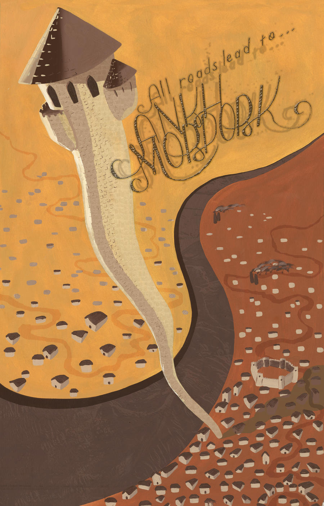

\sinc

Hoy en día, y eso te lo confirma cualquier autora de rol mínimamente competente (no como nosotras), hay que empezar _In medias res_, así que tus jugadoras van a comenzar sus andanzas en todo el meollo. La jueza levanta el mazo y …

---

\conc

Y tras caer el mazo y oír culpable, simplemente mira a tus jugadoras y pregunta una por una y a poder ser por separado cómo han acabado formando parte del Gremio de presidiarias de Ankh-Morpork. Tras su explicación dales una consecuencia apropiada, como ya vimos en la creación de personajes.

Estas escenas deberían ser en privado, para que cada jugadora sepa solo su historia y sus consecuencias. Qué luego después de la partida se las van a contar para molarse entre ellas, pero tú estás haciendo lo correcto, lo que un DJ serio y formal haría en estos casos. Ya habrá tiempo de llevarte por el camino.

> Toca borrar la organización de la ficha y poner Gremio de presidiarias.

Si ya estaban en la cárcel y eran parte del gremio de presidiarias, la jueza puede ser la directora de la junta de la condicional estampando el sello de «Rechazado» en su solicitud de libertad condicional.

Los guardias, exactamente dos trolls de gran tamaño, se acercarán y se llevarán a tus presidiarias, pero de entre la multitud se levantará un hombre de unos 50 años, calvo y en mala forma física y se dirigirá a la mesa del juez o la junta de la condicional.

— Señorías, como agente censal nominado por el propio Patricio y siguiendo la normativa municipal 314, puedo proponerles a estas infelices almas perdidas otra opción diferente, para no tener que formar parte del Gremio de presidiarias de esta ciudad.

El Patricio decidió, en su día, elaborar un censo electoral. Si las ankhmorporkianas se ponían en su contra y a alguna de sus enemigas políticas le daba por inventar y testar la guillotina, podía decir, si le preguntaban por su política democrática de «un hombre (él), un voto (el suyo)», que estaba trabajando en mejorarlo y ampliarlo. 

El Patricio no quería gastar mucho y como las cárceles estaban llenas, decidió montar un indulto a las presidiarias que decidieran participar en el censo. Cada mes de curro haciendo encuestas censales era un año menos de condena.

El tema es que la esperanza de vida de una encuestadora es muy baja, casi nula. La mayoría acababan sobre el río Morpork con más metal del que las autoridades médicas (de existir) recomendarían.

Así que se corrió la voz de que el indulto no era bueno para la salud y las presidiarias no se apuntaban al indulto. Asi que este se terminó olvidando. Hasta hoy.

Wilbuck continúa dirigiéndose a la jugadora: 

\sp

— Por cada mes de trabajo en la Agencia Central Censal, se le indultará un año de condena, además obtendrá pensión completa y un pequeño estipendio (no es lo que piensas, esto es un sueldo y tú pensabas en una filacteria de un liche). Solo tendrán que hacer preguntas a la gente y traerme las respuestas. — Mientras saca un montón de papeles, le da el ultimátum – Si estás interesada, firma o pon tu marca aquí.

> Vuelve a borrar tu organización y escribe ahora Agencia Central del Censo

Wilbuck hará que les siga a las oficinas de la Agencia Central del Censo, un asqueroso almacén en los muelles de la ciudad.

El almacén es un pequeño edificio mugriento en el que hay montones de archivadores con llaves. Se oye todo el rato golpes entre los archivadores, son borrones que aparecen, abren el archivador, lo cierran y desaparecen. 

En realidad, son diablillos hiperactivos al servicio de Wilbuck, que le buscan y traen carpetas con datos estadísticos.

> Está todo tan mal distribuido que parece más grande por fuera que por dentro. Parece cosa de magia y más o menos lo es. El 8 es el número de la magia y hay tantos 8 escritos en un mismo sitio que el campo mágico de Mundodisco se va a la mierda. Un 88,88% más en alguna estadística de algún informe y el almacén podría colapsar sobre el mismo y acabar la Dimensión Mazmorra.

&nbsp;

Les explicará su trabajo, que es principalmente elaborar el censo de la ciudad haciendo entrevistas a las amables y cooperativas ciudadanas de Ankh-Morpork, pero como su presupuesto es ridículo, no ha avanzado mucho.

Les enseñará un archivador en su pequeño despacho con unas pocas carpetas. El resto de clasificadores del almacén son para otros datos que ha ido recogiendo por su cuenta.

Ha montado unos camastros con una cocina en una de las esquinas del almacén. Wilbuck les deja tranquilos, hasta el día siguiente para hacer lo que quieran. Pero deben presentarse a las 9:00 en su oficina. Si se fijan, no hay ningún tipo de seguridad que les impida entrar o salir.

\sp

Recuerda que las consecuencias que adquirieron al principio de la campaña debido a lo que le llevo a la cárcel, sigue activa y en la cárcel no podrían tocarles, pero aquí sí, porque no hay ningún tipo de seguridad para salir y para entrar.

\sinc

## Agentes censales novatas

\conc

Se levantarán con una resaca terrible por la juerga que se pegaron ayer. Es lo que tiene ir a la cárcel, cuando sales quieres volver a disfrutar de la vida, aunque oficialmente solo hayas estado escasos segundos.

> Oficialmente son expresidiarios, así que como establecimos en la creación de personajes ya pueden empezar a usar las ventajas que da ser expresidiarios.

Es su primer día oficial de indulto, así que no deberían llegar tarde a la oficina de Wilbuck. Lo bueno es que la cafetera está cerca de su oficina y lo primero que necesitaran será café.

Wilbuck les espera sentado en su oficina y allí les explicará las normas básicas de trabajo.

* Eres libre de entrar y salir como quieras, mientras cumplas tus horas de trabajo.
* Si te acabas el café te toca hacer una nueva cafetera.
* En tu cumpleaños traes sidra y pastel de los enanos para todo el almacén.

> Hay montones de diablillos trabajando en el hospital, así que todos los días es el cumpleaños de tres o cuatro y la cocina está llena de pastel de los enanos que nadie quiere porque sabe fatal. Curiosamente, nunca sobra sidra

Si alguna jugadora es ladrona, perista o de otras profesiones con lo ajeno, verá que, si bien todo en la oficina es cutre y viejo, las herramientas de cálculo, como el ábaco, es de gran calidad (marfil, ébano, oro, …) y los utensilios de escritura, como tinteros y plumas, parecen que son de lujo.

Todo esto es demasiado para el sueldo de un trabajador público, pero, claro, los sobresueldos no oficiales es otra cosa. Aunque nadie sabe para qué sobornarías al del censo de un sitio donde solo vota el Patricio.

Según les comenta Wilbuck, el censo oficial, en Ankh-Morpork hay 172 habitantes censados incluyendo al Patricio y Wilbuck. Está claro que el censo no es muy grande, pero para Wilbuck, por su cara, le parece todo un triunfo.

### El peso de la placa

Wilbuck les hará entrega de una placa metálica con el escudo de la ciudad y grabado «Agente censal». Sabe que las posibilidades de supervivencia de tus jugadoras, mejoran con esas placas. 

\sp

Mucha gente no sabe ni leer y menos que sería un agente censal, pero se parecen mucho a las de la guardia de la ciudad y nadie quiere problemas con las chicas del Capitán Zanahoria.

La placa les va a dar ciertas capacidades, buenas unas y malas otras.

[ESPERAR A LAS REGLAS TRADUCIDAS XXX]

\sinc

## El cuestionario

\conc

Tras las placas les explicará sus funciones principales, hacer las encuestas. Les entregará una carpeta con varios cuestionarios en papel. Los papeles están unidos por unos hierros retorcidos que evitan que se separen que Wilbuck ha inventado para gestionar toda la documentación que mueven en el almacén.

> Seguro que tienes alguna listilla en tu mesa, así que si te dice que son clips, diles que grapas y si dicen grapas, diles clips. Marca tu territorio y demuéstrales quien manda. No dejes que se te suban a las barbas, sobre todo si eres una enana.

XXX

Wilbuck está entusiasmado con sus nuevos agentes. Está convencido de que el proyecto va a avanzar mucho con ellos

De hecho, está demasiado contento, cualquier otro empleado público de Ankh-Morpork, le valdría con trabajar lo mínimo y cobrar a fin de mes, pero Wilbuck parece muy contento. Parece casi casi como si disfrutara de su trabajo. Eso solo le pasa al Patricio y a los asesinos en serie que siempre saludan. Los que no saludan tampoco disfrutan de su trabajo.

XXX

Además de nombre, profesión, fecha de nacimiento (Wilbuck sabe por experiencia que es mejor que preguntar la edad porque mucha gente no sabe que ambos datos tienen una relación matemática) y otros datos demográficos normales, les tocará hacer algunas de estas preguntas.

* **¿Ketchup o mostaza?** El Patricio no cree en la mayonesa como salsa para los perritos calientes ni para las patatas fritas.
* **¿Perros o gatos?**
* **¿Es usted terraesferista?** ¿Cree que el mundo es una esfera que vaga sola por el espacio sideral?
* **¿A qué diosas no rezas?** Es más rápido así.
* XXX

XXX

\sp

\sinc

## A patearse los adoquines

\conc

XXX

Por mucho que tus jugadoras se lo curren cualquier intento de hacer alguna encuesta es de un d4 y  un d6, si se les ocurre alguna idea tremendamente buena.

XXX