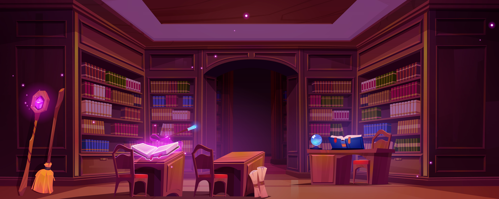

\sinc

&nbsp;

Empezar el censo en las peores calles de la ciudad, igual no es buena idea. Puede que si subimos el nivel intelectual de los encuestados (porque solo hay magos, masculino no-genérico) en la Universidad Invisible, la cosa vaya mejor. Con tus jugadoras (esta vez sí, plural femenino genérico) haciendo ese trabajo ya sabes la respuesta, será un puro desastre.

---

\conc

XXX

\sinc

## Entra Spandau

\conc

XXX

Para ver quien tenía que acompañar a los empleados del censo, lo decidieron como se elige a los reyes, ponen todos la mano en parte de abajo de la gran mesa de reuniones y sacan un chicle pegado, al que le toca el chicle verde clorofila pierde. Desgraciadamente, Ville saco un moco verde que contaba como chicle de clorofila, así que perdió y encima puede que haya cogido alguna enfermedad mágica rara.

XXX

\sinc

## ¿Qué son esos tubos llenos de bichos?

\conc

XXX

\sp

### Hex, el superhormiguero computacional

XXX

\sinc

## Y por eso no hay que dejar comida cerca de HEX

\conc

XXX

\sinc

## ¡¡¡Al abordaje!!!

\conc

XXX

Trazcuatro es bastante escurridiza y ha hecho sus deberes aprendiéndose como va el sistema de calefacción de la Universidad y el de alcantarillado. La verdad es que teniendo en cuenta que hay partes de la universidad que están en varios a la misma vez o en distintas lineas temporales, saber moverse por los conductos de la calefacción es bastante impresionante. Un mal giro y acabas en el continente contrapeso cuando los lagartos gigantes dominaban el disco.

Así que para atraparla tendrán que hacer uso de toda su (poca) inteligencia y de su (mucha) suerte. XXX

XXX

### ¿Qué está buscando Trazcuatro?

XXX
\sp

\sinc

## Algo huele a chamusquina en la oficina

\conc

XXX

Esos pequeños detalles deberían empezar a hacer sospechar a tus jugadoras de Moreless no es limpio. No es necesario que seas muy claro, simplemente planta una semillita de duda y riégala con paranoia. Piensa que llevas dos capítulos y no ha aparecido ningún enemigo claro. Seguramente las cabecitas de tus jugadoras ya estén buscando de que va la campaña y quien es su némesis.

XXX

\sp

\sinc

## Cameos y momentos estelares

\conc

La Universidad Invisible es un lugar genial para tener momentos estelares, porque todo es posible. Rayos mágicos perdidos, maldiciones sin control y personajes muy extravagantes.

* Un rayo mágico de quién sabe donde alcanza a tu jugadora. Desde ese momento puede leer las mentes, literalmente. Lo que la gente piensa aparece escrito en su frente (y con faltas de ortografía). Lo que no sabe, a no ser que se lo digan el resto, es que todo lo que está pensando también aparece en su frente.
* Hay una cata ciega para el concurso del mejor vino de retrouvas. A los magos les encanta el vino de retrouvas, por eso de jugar con el «continuum» del tiempo y joderlo irremediablemente. Uno de los catadores oficiales esta ya de reseca de la borrachera que va a tener después de la cata y está indispuesto. Tu jugadora deberá participar, pero debe tener cuidado porque si se emborracha sin haber tenido antes la resaca puede romper el continuo espacio-temporal o pillar una diarrea muy grave. 
* Un libro con lomos de hierro y cadenas rotas aparece aleteando contra tu jugadora y se cierra atrapando la cara de tu jugadora. Lo que haga a partir de ahora es cosa de tu jugadora, cierra los ojos y lee lo que ponga, los cierras, trata de quitárselo, las opciones son muchas. Sea como dale alguna ventaja temporal para que se mole, como volverse invisible, o flotar (que no volar). Hay jugadoras a las que les gusta el drama, así que también puedes tirar por ese camino. Quizás ahora le siga la mala suerte o atraiga la mala suerte a los demás, o tal vez no pueda volver a usar la S y «zolo pueda comunicarze con la zeta».

Estos son los personajes que puedes meter si la historia decae:

* **Rincewind:** Sea como sea el cameo, Rincewind estará corriendo mientras se agarra su sombrero con una mano y se sujeta la túnica con la otra. Y detrás del mago vendrá algo malo, siempre. Si quieres, que tus jugadoras dejen un lugar, ver a Rincewind pasar como una exhalación es la mejor manera.
* **El bibliotecario:** Sí o sí hay que sacar al bibliotecario. Quizas este en el comedor comiendo sus cereales o le vean fugazmente moviéndose acrobáticamente entre los pasillos de su biblioteca dejando libros en los estantes más altos. Y no te olvides de hacer los «Ook» de rigor.
* **Cohen el bárbaro:** El bárbaro no suele acercarse a la magia, pero nada impide que se haya metido una gesta menor de matar ratas en las cloacas por dinero, se haya perdido y haya salido por los desagües de la Universidad Invisible. Quizás salude y se vuelva a bajar a las alcantarillas o quizás robe algo cercano, brillante y/o que parezca de valor.