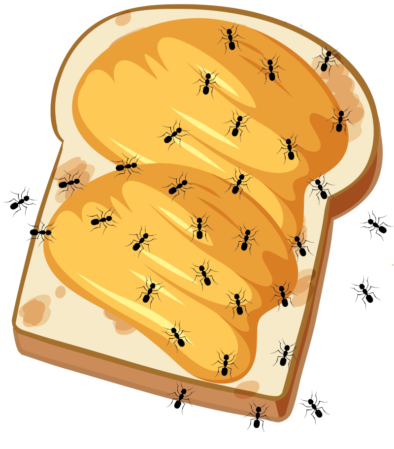

\sinc

&nbsp;

Empezar el censo en las peores calles de la ciudad, igual no es buena idea. Puede que si subimos el nivel intelectual de los encuestados (porque solo hay magos, masculino no-genérico) en la Universidad Invisible, la cosa vaya mejor. Con tus jugadoras (esta vez sí, plural femenino genérico) haciendo ese trabajo ya sabes la respuesta, será un puro desastre.

---

\conc

Tras unos días de hacer encuestas en Las Sombras con resultados desastrosos, Wilbuck reúne a tu mesa en su ofician y les empieza a hablar de porcentajes, de tartas, de barras y de muchas cosas que no entendéis. 

> Vaya chasco que se llevarán tus jugadoras que esperan que las tartas sean de chocolate y las barras de caramelo y en realidad son dibujos feos con círculos y rectángulos de colores.

En resumen, que va a cambiar de objetivo (algo que no tiene nada que ver con asesinatos, desgraciadamente) y va a hacer encuestas en la Universidad Invisible. Allí están las mentes más sabias de la ciudad o eso dice las vacas publicitarias que pusieron en las puertas de entrada de Ankh Morpork.

Algún genio de las mercaderías decidió que era una idea genial montar unas grandes vallas en los campos de alrededor de la ciudad y alquilarlas para que los comerciantes pudieran poner mensajes ofreciendo sus productos y servicios a cambio de dinero. El problema es que su ayudante escribió vaca en vez de valla.

Ha conseguido un permiso especial del archicanciller Mustrum Ridcully el Marrón, que no entiende mucho de encuestas y censos, pero al que Wilbuck se lo ha vendido como una fuente de información interesante y de chismes que le puede ser muy útil para seguir en su cargo.

> Este tipo de detalles deberían empezar a hacer saltar las alarmas a tus jugadoras de que Wilbuck no es tan neutro y plano como parece y que hace cosas un tanto cuestionables. Que esto es Mundodisco y lo éticamente correcto es muy difuso, pero con que alguna jugadora pregunte si eso no es un poco ilegal ya nos vale.

\sp

Con el salvoconducto del archicanciller y un sándwich de cordero, lechuga y tomate (cuando el cordero es rico y magro y los tomates están maduros) Wilbuck les enviará a la Universidad Invisible a ver si aquí consiguen mejores resultados que en el intento anterior.

\sinc

## Entra Spandau Ville

\conc

Enseñando la placa rápidamente (con lo que el personal encargado del control del acceso a la Universidad se piensa que eres de la Guardia de la ciudad) y con el salvoconducto del archicanciller, no deberían tener ningún problema para entrar. Aunque siempre puedes usar el viejo «No sé Rick, parece falso» y tocarles las narices un rato a tus jugadoras.

Wilbuck les han dado un nombre, Spandau Ville, que tiene pinta que es el pringao al que le ha caído el marrón de guiar a tus jugadoras por la universidad para hacer las encuestas. Según se le encuentren verán que es verdad, Spandau es un pringadete. 

Para ver quién tenía que acompañar a los empleados del censo, los magos novatos de la universidad lo decidieron como se elige a los reyes. Ponen todos la mano en parte de abajo de la gran mesa de reuniones y sacan un chicle pegado, al que le toca el chicle verde clorofila pierde. Desgraciadamente, Ville ni se atrevió a meter la mano debajo de la mesa porque es germófobo, así que perdió automáticamente. 

Spandau empezará su ruta por la universidad llevándoles de cátedra en cátedra y de despacho en despacho para encuestar a los magos que Wilbuck ha puesto en su listado.

No es necesario hacer nuevas entrevistas, pero si tus jugadoras se lo pasaron bien en el capítulo anterior aquí tiene algunas ideas (recuerda que en algún momento dejaremos de darte ideas y tendrás que currártelo tú misma).

* Cuando abren la puerta de su despacho se ven los baños, si la cierran y vuelven a abrir las cocinas, los comedores, la carbonera, etc. Cuando se vayan, verán a un mago entrar al despacho y si vuelven a intentar abrir la puerta dará otra vez a los baños. Lo única forma de entrar es que abra la puerta un mago como Spandau, cosa que ni él sabe.
* Han interrumpido al mago al que tienen que hacerle la encuesta en mitad de **un experimento en el que está trayendo versiones suyas del presente y del pasado**. La cuestión es que todos ellos son el mago que quieren encuestar y, contrariamente a lo que pasa la mayoría de las veces, todas las versiones quieren contestar a las preguntas del censo. Empezarán a discutir entre ellos porque sus respuestas no son las mismas aunque sean el mismo mago. Por otro lado, aunque sean versiones del mismo mago de diferentes años, todas visten igual (de mal) y tienen el mismo peinado (horrible). Así que es imposible saber con qué versión estás hablando.

\sp

* El mago es solo **una cabeza en un tarro de cristal** cerrado lleno de un líquido espeso encima de su mesa de trabajo. Parece que habla porque abre la boca y salen burbujas, pero no se le entiende nada. Si quieren rellenar su cuestionario, deberán buscar una manera de comunicarse con él. No pueden sacarlo del tarro, porque hay un lacre que sella el tarro y que tiene un papelito atado que dice «Garantía cancelada, si el sello está roto».

\sinc

## ¿Qué son esos tubos llenos de bichos?

\conc

Tras algunas entrevistas y una parada de rigor en la cafetería de la universidad para probar sus famosos pedetes de azúcar y unos tés de canela de cedro, Spandau les llevará al edificio de investigación de Magia de Altas Energías. Allí trabajan ser sus próximos encuestados.

Según se acercan, por los techos hay tubos llenos de tierra por los que andan hormigas para arriba y para abajo. Spandau, les explicará que eso es parte HEX, una especie de máquina viviente que hace cálculos complicadísimos, y orgullosamente les explicará que él se encarga del mantenimiento del hormiguero 

### Hex, el superhormiguero computacional

XXX

> ¿Y esto qué es? ¿Un cameo o algo importante para la trama? Pues sinceramente las dos cosas, cuando me hablaron de este «personaje» me dije: Me viene genial para la historia y encima es un cameo. ¿Qué más puedo pedir?

### Y por eso no hay que dejar comida cerca de HEX

De repente, Spandau gritará de sorpresa. No para de mirar los tubos de los bichos y no deja de mascullar:

– Y por eso no hay que dejar comida cerca de HEX. Mira que ponemos carteles. Horas perdidas poniéndose los carteles en todos los idiomas de esta dimensión y del espacio L para nada.

\sp
 
En unos segundos sacará un sandwich de mantequilla de cacahuetes con mermelada de frambuesa lleno de hormigas que fueron a coger comida y quedaron atrapados en su pringue.

> Mantequilla de cacahuetes en plural. Los productores tuvieron problemas al comercializarla, porque la gente pensaba que solo se usaba un cacahuete en hacerla todo un tarro. La lógica diría que también debería ser mermelada de frambuesas, pero ahñi no hubo problemas. Esta claro que hay cierta animadversión hacia los frutos secos y sus productos derivados.

– ¡¡¡Sabotaje!!! Esto es sabotaje – Grita a tus jugadoras mientras agita el sandwich y les llena la cara de mantequilla de cacahuetes y mermelada de frambuesa.

Se pondrá a buscar y, si tus jugadoras le ayudan, encontrarán toda una serie de dulces para atraer a las hormigas: piruletas, roscones de miel, pasteles de mermelada, etc.

Curiosamente no se han acercado a los bollos dulces de los enanos. Bueno, de curioso nada, ni los propios enanos se acercan. Estudiando donde estaban los bollos, parece que se han usado para hacer que las hormigas no fueran por ciertas partes.

Todo indica que alguien ha querido usar a HEX sin los permisos necesarios y se ha buscado la manera de desviar el flujo computacional de hormigas a otra parte del edificio para hacer sus propios cálculos.

Según Spandau, el proceso es lento, así que la pirata computacional se ha ido para volver en unas horas o estará escondido cerca esperando a que los tubos se llenen de hormigas, unas 100 hormigas exactamente. Cuando el tubo este lleno al 100% de hormigas se puede empezar a trabajar. A esto le llaman barra de carga de hormigas.

\sinc

## ¡¡¡Al abordaje!!!

\conc

XXX

Trazcuatro es bastante escurridiza y ha hecho sus deberes aprendiéndose como va el sistema de calefacción de la Universidad y el de alcantarillado. La verdad es que teniendo en cuenta que hay partes de la universidad que están en varios espacios de existencia a la vez o en distintas líneas temporales, saber moverse por los conductos de la calefacción es bastante impresionante. Un mal giro y acabas en el continente contrapeso cuando los lagartos gigantes dominaban el disco.

Así que para atraparla tendrán que hacer uso de toda su (poca) inteligencia y de su (mucha) suerte. XXX

XXX

\sp

> Durante todo esta escena, todo toma un tono verdoso fosforescente, seguramente algún hechizo perdido o mal ejecutado. De hecho, por el rabillo del ojo tus jugadoras pueden ver runas extrañas verdes que caen y de lejos se oye una música machacona y repetitiva, digna de los mejores intérpretes trolescos.

### ¿Qué está buscando Trazcuatro?

Al encontrarse atrapada y sin salida Trazcuatro cambia de estrategia. Quizas, si explica las razones de su pirateo de HEX, pueda salir airosa de esta situación y no acabe en un calabozo de la guardia de la ciudad.

Trazcuatro necesita usar de forma ilegal (algo que ella llama jaquequear, porque le produces jaquecas al que se encarga de proteger lo que quieres usar ilegalmente) la supercomputadora HEX para poder hacer unos cálculos para su sistema de comunicación basado en tuberías de agua.

Quiere calcular si su sistema de envío de mensajes por tuberías de agua es posible. En vez de molestas torres de clacs, habría pozos subterráneos que mandarían señales dejando pasar agua por tuberías entre pozos. Al otro lado de la tubería habría una especie de molinillo con cabeza de patito que se movería con el agua y que haría ruidos para dar los mensajes.

> Si alguna jugadora te dice que eso no es factible, saca tu título de «Terry Pratchett espacio-temporal» y dile que el campo mágico de Mundodisco llena el agua de octarino y modifica la física de su hidrodinámica. Pero si fuera yo, le quitaba un punto de Suerte por tocanarices.

La teoría de Trazcuatro es que su sistema no es «jaquequeable», porque los piratas de clacs no ven las señales como con los semáforos de luces (el agua va dentro de tubos bajo tierra) y segundo porque la mayoría de piratas no se acercan nunca al agua más que una vez al año. Además, es una forma de poner agua en las casas de la gente.

Durante un tiempo tuvo la teoría de que el agua tiene memoria y quizas podía mandar mensajes usando su memoria molécula a molécula. El problema es ue al agua no le gustan ser una cotilla, así que puedes contarle un chisme a una molécula de agua, pero no se lo pasa a la siguiente molécula, así que la comunicación era imposible,  

> Sí, efectivamente, Trazcuatro quiere convertir un sistema inalámbrico como las torres de clacs en un sistema alámbrico. Estas cosas solo pasan en Mundodisco.

### ¿Qué hacemos con Trazcuatro?

XXX

\sp

\sinc

## De vuelta en la oficina

\conc

Tras sus aventuras en la universidad pueden volver a la oficina. Otra vez, seguramente, han fracasado al intentar rellenar más encuestas, pero las cosas que cuenten de HEX y las ideas de Trazcuatro, le abrirán la mente a Wilbuck.

Si los cálculos de Trazcuatro son correctos, Wilbuck podría comprar más almacenes, llenarlos de archivadores y conectarlos con tuberías para poder pasar información entre ellas y aumentar la capacidad de hacer esta-listicas y todo el poder que ello conlleva.

Quería usar torres de clacs, pero la empresa que los fabrica no quiere vendérselos y tampoco quiere que los piratas de clacs lean sus comunicaciones y descubran sus planes.

Por unos segundos estará más interesado en Trazcuatro que en las encuestas y de normal no hay nada más interesante que las encuestas. De hecho, se le pondrá una sonrisa bobalicona mientras le hablan de Trazcuatro y su proyecto. 

### Algo huele a chamusquina en la oficina

En principio tras salir de la reunión con Wilbuck tus jugadoras deben empezar a detectar que algo «raromalo» pasa con Wilbuck y su proyecto. Hay pequeños detalles que deberían empezar a hacer sospechar a tus jugadoras de Moreless no es trigo limpio. No es necesario que seas muy claro, simplemente planta una semillita de duda y riégala con paranoia.

Piensa que llevas dos capítulos y no ha aparecido ningún enemigo claro. Seguramente las cabecitas de tus jugadoras ya estén buscando de que va la campaña y quién es su némesis.

> Por cierto, si a una de tus jugadoras se le ocurre escribir un guion sobre sus aventuras en la universidad, titularlo «Las locas aventuras en la universidad» y vendérselo a una chusca productora de imágenes en movimiento de Holy Wood, que sepa que ha inventado el género de las comedias universitarias locas. No es un gran aporte a la historia de las imágenes en acción, pero oye como mínimo aparecerás en las futuras crónicas del séptimo arte. Eso, si escriben tu nombre sin faltas de ortografía, si no, seguramente, la fama y la inmortalidad histórica pasarán a tu lado sacándote la lengua y haciéndote un corte de mangas.

\sp

\sinc

## Cameos y momentos estelares

\conc

La Universidad Invisible es un lugar genial para tener momentos estelares, porque todo es posible. Rayos mágicos perdidos, maldiciones sin control y personajes muy extravagantes.

* Un rayo mágico de quién sabe donde alcanza a tu jugadora. Desde ese momento puede leer las mentes, literalmente. Lo que la gente piensa aparece escrito en su frente (y con faltas de ortografía). Lo que no sabe, a no ser que se lo digan el resto, es que todo lo que está pensando también aparece en su frente.
* Hay una cata ciega para el concurso del mejor vino de retrouvas. A los magos les encanta el vino de retrouvas, por eso de jugar con el «continuum» del tiempo y joderlo irremediablemente. Uno de los catadores oficiales esta ya de reseca de la borrachera que va a tener después de la cata y está indispuesto. Tu jugadora deberá participar, pero debe tener cuidado porque si se emborracha sin haber tenido antes la resaca puede romper el continuo espacio-temporal o pillar una diarrea muy grave. 
* Un libro con lomos de hierro y cadenas rotas aparece aleteando hacia tu jugadora y se cierra atrapando la cara de tu jugadora. Lo que haga a partir de ahora es cosa de tu jugadora, cierra los ojos o los abre y lee lo que hay escrito, los abre un poquito, pero sin mirar directamente, las opciones son muchas. Sea como sea, dale alguna ventaja temporal para que se mole, como volverse invisible (dejando un contorno borroso), o flotar (que no volar). Hay jugadoras a las que les gusta el drama, así que también puedes tirar por ese camino. Quizás ahora le siga la mala suerte o atraiga la mala suerte para los demás, o tal vez no pueda volver a usar la S y «zolo pueda comunicarze con la zeta».

Estos son los personajes que puedes meter si la historia decae:

* **Rincewind:** Sea como sea el cameo, Rincewind estará corriendo mientras se agarra su sombrero con una mano y se sujeta la túnica con la otra. Y detrás del mago vendrá algo malo, siempre. Si quieres, que tus jugadoras dejen un lugar, ver a Rincewind pasar como una exhalación es la mejor manera.
* **El bibliotecario:** Sí o sí hay que sacar al bibliotecario. Quizas este en el comedor comiendo sus cereales o tal vez le vean fugazmente moviéndose acrobáticamente entre los pasillos de su biblioteca dejando libros en los estantes más altos. Y no te olvides de hacer los «Ook» de rigor.
* **Cohen el bárbaro:** El bárbaro no suele acercarse a la magia, pero nada impide que se haya metido una gesta menor de matar ratas en las cloacas por dinero, se haya perdido y haya salido por los desagües de la Universidad Invisible. Quizás salude y se vuelva a bajar a las alcantarillas o quizás robe algo cercano, brillante y/o que parezca de valor.