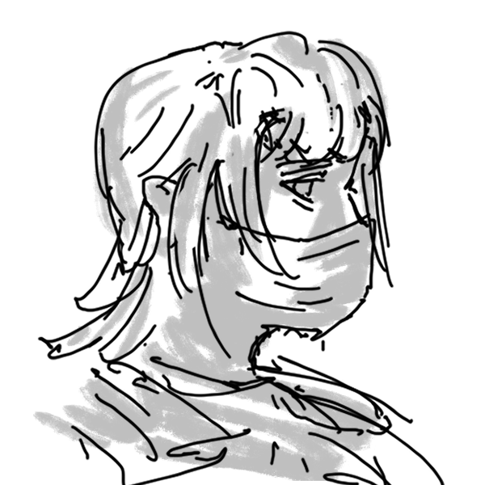

## El cuestionario

\conc

Tras las placas les explicará sus funciones principales, hacer las encuestas. Les entregará una carpeta con varios cuestionarios en papel. Los papeles están unidos por unos hierros retorcidos que evitan que se separen que Wilbuck ha inventado para gestionar toda la documentación que mueven en el almacén.

> Seguro que tienes alguna listilla en tu mesa, así que si te dice que son clips, diles que grapas y si dicen grapas, diles clips. Marca tu territorio y demuéstrales quien manda. No dejes que se te suban a las barbas, sobre todo si eres una enana.

XXX

Wilbuck está entusiasmado con sus nuevos agentes. Está convencido de que el proyecto va a avanzar mucho con ellos

De hecho, está demasiado contento, cualquier otro empleado público de Ankh-Morpork, le valdría con trabajar lo mínimo y cobrar a fin de mes, pero Wilbuck parece muy contento. Parece casi casi como si disfrutara de su trabajo. Eso solo le pasa al Patricio y a los asesinos en serie que siempre saludan. Los que no saludan tampoco disfrutan de su trabajo.

XXX

Además de nombre, profesión, fecha de nacimiento (Wilbuck sabe por experiencia que es mejor que preguntar la edad porque mucha gente no sabe que ambos datos tienen una relación matemática) y otros datos demográficos normales, les tocará hacer algunas de estas preguntas.

* **¿Ketchup o mostaza?** El Patricio no cree en la mayonesa como salsa para los perritos calientes ni para las patatas fritas.
* **¿Perros o gatos?**
* **¿Es usted terraesferista?** ¿Cree que el mundo es una esfera que vaga sola por el espacio sideral?
* **¿A qué diosas no rezas?** Es más rápido así.
* XXX

XXX

\sp

\sinc

## A patearse los adoquines

\conc

XXX

Por mucho que tus jugadoras se lo curren cualquier intento de hacer alguna encuesta es de un d4 y  un d6, si se les ocurre alguna idea tremendamente buena.

XXX

---

\sinc

## Trazcuatro (alias Traz4)

**Pirata de los clacs (ELLA)**

\conc

* Muy competente en varias artesanías.
* Le encantan los números y los simbólicos raros que se usan vez de números.
* Pasa desapercibida en todas partes.

XXX