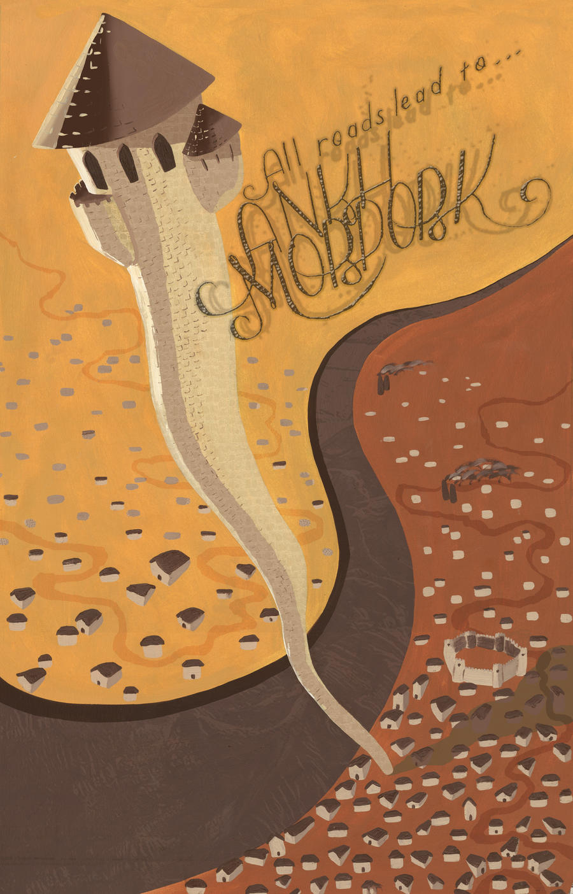

> Vuelve a borrar tu organización y escribe ahora Agencia Central del Censo

XXX

Wilbuck les deja tranquilos, hasta el día siguiente para hacer lo que quieran. Pero deben presentarse a las 9:00 en su oficina.

\sinc

## Agentes censales

\conc

Es su primer día oficial de indulto, así que no deberían llegar tarde a la oficina de Wilbuck, de hecho sus habitaciones están al lado.

Según les comenta Wilbuck, el censo oficial, en Ankh-Morpork hay 172 habitantes censadas incluyendo al Patricio. Está claro que el censo no es muy preciso, pero para Wilbuck, gerente municipal del censo, es todo un triunfo.

Wilbuck les hará entrega de una placa metálica con el escudo de la ciudad y escrito «Agente censal». Sabe que las posibilidades de supervivencia de tus jugadoras, mejoran con esas placas. Mucha gente no sabe ni leer y menos que sería un agente censal, pero se parecen mucho a las de la guardia de la ciudad y nadie quiere problemas con las chicas del Capitán Zanahoria.

[ESPERAR A LAS REGLAS TRADUCIDAS XXX]

\sp

\sinc

## El cuestionario

\conc

XXX

Además de nombre, profesión, fecha de nacimiento (Wilbuck sabe por experiencia que es mejor que preguntar la edad porque mucha gente no sabe que ambos datos tienen una relación matemática) y otros datos demográficos normales, les tocará hacer algunas de estas preguntas.

* **¿Ketchup o mostaza?** El Patricio no cree en la mayonesa como salsa para los perritos calientes ni para las patatas fritas.
* **¿Perros o gatos?**
* **¿Es usted terraesferista?** ¿Cree que el mundo es una esfera que vaga sola por el espacio sideral?
* **¿A qué diosas no rezas?** Es más rápido así.
* XXX

---

\sinc

## Trazcuatro (alias Traz4)

**Pirata de los clacs (ELLA)**

\conc

* Muy competente en varias artesanías.
* Le encantan los números y los simbólicos raros que se usan vez de números.
* Pasa desapercibida en todas partes.

XXX