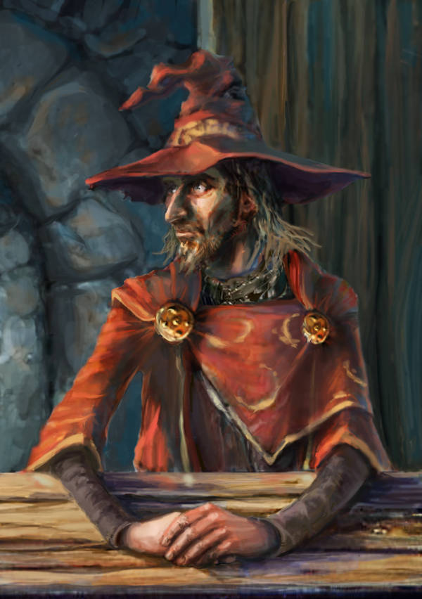

\sinc

Esta campaña tiene una serie de reglas especiales que, si bien no modifican las reglas generales de «Terry Pratchett’s Discworld: Adventures in Ankh-Morpork», añaden algunas nuevas para darle el sabor específico que se busca en esta campaña.

---

\conc

Seamos sinceros, son solo un montón de tonterías que NO HAN SIDO TESTEADAS, pero que en la mente del autor sonaban de fábula. En fin, puede que sean divertidas, si tu mesa se deja llevar.

Por resumir, aquí tienes reglas para llevar practicantes de la Esta-Ĺistica, como funciona _la campaña_ con sus cameos y su tono «woke», además de reglas especiales para la creación de personajes.

\sinc

## La Esta-Listica

\conc

La Esta-Listica (hay que pronunciarlo con voz grave, porque las cosas de la magia se pronuncian con voz grave) es la magia de los datos y los porcentajes y puede parecer banal, pero en un mundo muchas veces muy literal es una forma de magia muy poderosa.

Este tipo de magia permite predecir el futuro. En realidad permite saber qué posibilidad de las infinitas que pueden ocurrir es la más probable, que es como predecir el futuro.

El único problema es que en vez de gastar octarino, esencia, karma, chi o lo que sea que usen otras taumaturgas para hacer hechizos, en la Esta-Listica necesitas datos, recabar grandes cantidades de datos. Sin datos no puedes predecir una mierda.

Y no solo sirve para dar profecías y predicciones, tiene muchas otras aplicaciones. Puedes convertirte en un luchador excepcional si sabes que ataque es más probable que lance tu oponente, o un asesino implacable si sabes cuál es porcentaje de muertes por rayos en función del tamaño y material del paraguas.

El departamento de numerología de la Universidad Invisible no lo considera una forma de magia y lo desprecian llamándola «pseudo-magia» o «ciencia» a secas.

```
¿Qué es eso de porcentajes? Eso no son números mágicos de verdad, como el donce, son patrañas científicas de las modernas.
```
**Irvín Visualblock, numerólogo**

Aun así las nuevas generaciones de numerólogos hacen sus pinitos con la Esta-Listica y no te extrañe que en unas décadas se impartan cursos de verano o incluso tenga su propia cátedra.

\sp

### Reglas de la Esta-Listica

En juego la Esta-Listica permite una gran variedad aplicaciones y más, si eres una DJ creativa y poco puñetera que gusta de hacer sufrir a sus jugadoras.

La Esta-Listica niega la Suerte, ya que son totalmente incompatibles, no existe la Suerte, solo unos porcentajes de éxito. Así que delante de una esta-lista, no se puede usar puntos de Suerte de forma que le afecte.

Por último, un practicante de la Esta-Listica puede demostrar que una situación o plan que tiene unas probabilidades de **uno entre un millón** en realidad son unas probabilidades de 0.000001%, que es ridículamente baja. Así que la regla de uno entre un millón no puede afectar a una esta-lista. La esta-lista no puede aprovecharse de esta regla, ni otros puede de usar esta regla en perjuicio o beneficio de la esta-lista.

> Nota importante, las practicantes de la Esta-Listica no son magos y, por tanto, la MUERTE no está obligada a ir a buscar su alama cuando muera. Lo cual no quiere decir que no vaya, pero solo si ella quiera. Quizás quiera que la esta-lista revise los datos y los porcentajes del informe trimestral de productividad que tiene que presentar la semana que viene.  

[ESPERAR A LAS REGLAS TRADUCIDAS]

### Reglas de los almacenes de datos

Los almacenes de datos son el arma suprema e Wilbuck y en juego los almacenes de datos permiten a Wilbuck prácticamente lo que se te ocurra, siempre y cuando tenga datos y pueda acceder a ellos a tiempo. 

Los almacenes pueden comunicarse entre ellos mediante la red de clacs (un sistema de comunicación que manda mensajes mediante destellos de luces desde altas torres), el poder cruzar los datos de varios almacenes de forma muy rápida puede darle mucho más poder aún, excepto los días de niebla. Esos días la comunicación se para, porque nadie ve a más de palmo de su cara.

[ESPERAR A LAS REGLAS TRADUCIDAS]

\sp

\sinc

## La campaña

\conc

La propia campaña (esta aventura que tienes entre manos) es un ente vivo dentro de la historia que si bien no habla con MAYÚSCULAS, sí lo hace en _cursiva_. Así que como mínimo es casi tan poderosa como la … MUERTE.

> Si te preguntas cómo vas a hacer para hablar en cursiva, es tu problema como directora. Como autora solo le tengo que dar al botón de cursiva del editor de texto, pero tú lo tienes más jodido.

La campaña necesita que sea jugada y contada y hará lo que sea para que tu mesa la termine. La idea principal es que cuando alguien diga que no puede venir a la siguiente partida, la campaña, temiendo que se termine cancelando, se buscará la manera de **darle un momento estelar** al personaje de esa jugadora.

Para ello, tal vez, la campaña se disfrace de un troll hiper-musculado que les reta a un pulso y al que, contra toda lógica, le ganes. O puede que aparezca como una bella manceba que le haga ojitos a la jugadora que dijo en el grupo de chat que igual dejaba de venir a las partidas.

> Al final de cada escena habrá una sección con posibles ideas de momentos estelares para que las uses con tus jugadoras.  Recuerda que solo son sugerencias y tú conoces a tu mesa, si crees que algo puede funcionar mejor, tírate a la piscina.  

Si el intento de dejar la partida o de no venir la próxima sesión es durante el juego, la campaña actuará inmediatamente, para enganchar a la jugadora desertora. Si el intento de deserción es entre sesiones, la campaña deberá actuar prometiendo cosas molonas en la próxima sesión en el chat grupal y cumpliéndolas en la siguiente sesión.

Si la campaña descubre que las jugadoras han pillado el truco de decir que no pueden jugar, le dará igual, lo importante es que la jueguen, pero que no abusen.

### Primera aparición 

Siguiendo las reglas del punto anterior la primera aparición de la campaña será cuando alguien avise de que falla o de que no pueda continuar.

Como es algo especial, en su primera aparición irá disfrazada de la MUERTE (túnica negra con capucha, cabeza de calavera, manos esqueléticas y una guadaña). El disfraz es muy bueno, pero se la pilla con cierta facilidad porque habla en cursiva y sus líneas de diálogo van precedidas de un guion.

> Volvemos otra vez a lo de cómo vas a hacer que se distingan las voces de estos personajes, porque en papel es fácil, pero en tu mesa de juego se complica mucho.

\sp

La campaña cree que con un cameo de un personaje importante de la saga de libros, pueda mantener la atención de las jugadoras.

Además, se ha pensado una estratagema sucia y rastrera para enganchar a las partidas a tus jugadoras. Todo se oscurecerá y se quedarán solas tus jugadoras en una gran negrura. De repente se podrán ver sus partes blancas y su guadaña y se presentará como la _muerte_. Estaba por el barrio, haciendo sus cosas. Pueden ver en un bolsillo de su túnica un pergamino enrollado donde se puede leer «Lista de …», que puede ser desde «Lista de las almas que tengo que segar hoy» hasta «Lista de ingredientes para la tarta de queso».

Bajará la guadaña de forma no ofensiva e irá acercándose a cada una de tus jugadoras y les dirá al odio (solo la jugadora lo sabrá) cómo van a morir de una forma bastante críptica.

_La campaña_ no sabe ciertamente cómo van a morir, pero espera que sus palabras tengan efecto en las jugadoras y que esto afecte a sus acciones.

Si le dice a una jugadora que las alturas son mortales de necesidad, esta se creerá inmortal mientras no se suba a un sitio alto o puede que se decida a luchar contra un dragón verdadero, esperando morir épicamente tras matarlo en pleno vuelo. 

Veamos algunos ejemplos que puedes usar y su aplicación en partida.

* **No deberías acariciar a las mascotas de nadie.** Una mascota puede ser el perro demonio de un demonólogo o el caniche piraña de una señora de la sociedad ankhmorporkiana.
* **El picante y otras especias puede tener efectos secundarios muy malos.** Quién dice especias, dice veneno y recuerda que hay picantes que queman al entrar y al salir.
* **El exceso de metales pesados en el organismo puede ser mortal.** Qué hierro puede ser un yunque en la cabeza, una puñalada trapera o una intoxicación por mercurio.
* **La magia es poderosa, pero también mortalmente peligrosa:** Y si rima es que es verdad, que dicen las abuelas.

De todas formas, tú conoces a tu mesa y sabes que es lo mejor para engancharlos a tu partida, que es lo que la _campaña_ quiere. Puedes dejar usar a tus jugadoras esta profecía como un rasgo en situaciones de vida o muerte.

### Y si nunca fallan o dicen que tienen que dejar la campaña

Compra lotería, porque eres un ser tocado por la providencia. No hay registros en los anales del rol en donde se haya recogido semejante situación. Si lo deseas, puedes escribirme y te pondré en la zona de agradecimientos. 

### Y si el que quiere dejar esta ponzoña de aventura eres tú

La campaña conoce a gente, gente muy chunga que puede hacerle cosas muy bestias a lo que más quieres, tu colección de libros de rol. Tú sabrás lo que haces, pero recuerda que toda acción o inacción tiene sus consecuencias.

\sp

De hecho, adquieres el rasgo «amenazado por la _campaña_». En este caso cuando tu mesa te diga algo, puedes usar este rasgo y conseguir un d12 cuando tengas que hablar con tus jugadoras sobre la marcha de la campaña (esta vez sin cursiva).

\sinc

## Creación de personajes

\conc

Si hemos retocado gran cantidad de elementos del juego principal, qué te hacía pensar que no íbamos a meter mano en la creación de personajes.

Para empezar, todas tus jugadoras forman parte del exclusivo gremio de presidiarias de Ankh-Morpork, así que en el apartado de «Organización» deberán poner «Excelso gremio de presidiarias de Ankh-Morpork».

¿Y qué ventajas tienes tiene esto? Pues no pocas. Lo primero un tatuaje presidiario como dios manda, puedes elegir un ancla, un amor de madre, una telaraña, un señor con un sombrero de ala muy ancha y bigote, un unicornio cuqui con alitas arcoíris, etc. Ponles algo ridículo y diles que viene en los estatutos del gremio.

Contar historias de la cárcel para ganar discusiones es otra ventaja. Imagina que queda un último trozo de empanada de anguila, puedes quedarte ese último trozo contando la anécdota de cómo le sacaste los ojos a un troll que intentó quedarse con tu trozo de empanada.

Es importante que sepas que las anécdotas policiales y militares ganan a las historias de prisión, tienen más caché. Eso explica que las pelis de polis y de guerra sacan más dinero en taquilla que las de fugas.

[](https://www.deviantart.com/marbolotte/art/Rincewind-530737566 "Rincewind por marbolotte")

&nbsp;

Además, deberían empezar con alguna consecuencia derivada de las acciones, segura y totalmente inocentes, que les llevaron a formar parte del gremio de presidiarias.

Esta consecuencia le espera acechando en los oscuros callejones (acechar a plena luz en una calle amplia es muy complicado) para atacarle en el peor momento o en el que haga más risas entre el resto de jugadoras.

\sp

Igual le buscan para matarle las víctimas de su estafa trapezoidal. Todo iba de maravilla hasta que alguien miro en un diccionario (ya es mala suerte timar a una con gusto por la lectura) y se dio cuenta de que no era una estafa trapezoidal sino piramidal, pero escalonada.

Quizás le busca el gremio de ladronas por meterse en sus asuntos. Mientras seas miembro del gremio de presidiarias y estés detrás de unos grandes muros, no pueden tocarte, pero si lo abandonas, vuelves a ser un objetivo eliminable.

Incluso, puede que entrar en la cárcel fuera la forma más inteligente que se le ocurrió de evitar un matrimonio concertado.

\sp

\sinc

## Cameos

\conc

Dicen las esta-listicas que si te paras en un lugar el suficiente tiempo, el famoso Cohen, el bárbaro ejeño, aparecerá y te robará el caballo. Es decir, las probabilidades de que tus jugadoras se encuentren con personajes famosos de Mundodisco son altas.

Todo lo anterior no es más que una excusa para justificar la gran cantidad de cameos «fanservice» que va a tener esta campaña. Y con esto quiero decir que va a haber cameos, muchos cameos y cada dos por tres saldrán personajes famosos de los libros.

> Al final de cada escena habrá una sección con posibles cameos de personajes famosos que pueden a parecer en ese momento de la campaña. Vendrán con ejemplos de ayudas que puede ofrecer o de obstáculos que poner a tus jugadoras.

\sinc

## Esta campaña es «woke»

\conc

Esta campaña es completamente «woke», así que, entre otras cosas, se ha usado el femenino genérico en todo este documento, por si no te habías dado cuenta.

Por otro lado, para fomentar que se cumpla el test de Bechdel (si no sabes lo que es, lo buscas), se ha creado una regla especial.

[ESPERAR A LAS REGLAS TRADUCIDAS]

```
Y el pecado, joven, es cuando tratas a la gente como cosas. Incluyéndote a ti mismo. Eso es lo que es el pecado.
```
**Yaya Ceravieja, bruja y a mucha honra**
